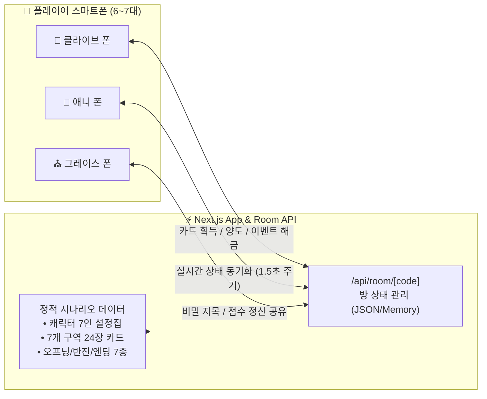

# 📱 《옛날 옛적 뉴프론티어에서》 스마트폰 웹 보조 앱(Web Companion) 상세 개발 계획서

> **목적**: 오프라인 대면 모임(6~7인)에서 인쇄물(종이 설정집, 실물 단서 카드 24장, 엔딩 북) 없이 **각자의 스마트폰 브라우저만으로 즉시 플레이**할 수 있는 모바일 웹 보조 앱의 아키텍처, 화면 설계, 데이터 구조 및 개발 순서를 정의합니다.

---

## 1. 기술 스택 및 시스템 아키텍처 (Tech Stack & Architecture)

오프라인 모임 현장에서 별도의 앱 설치 없이 **링크(URL) 또는 QR 코드 스캔 한 번**으로 아이폰·갤럭시 어디서든 접속할 수 있도록 구성합니다.

| 구분 | 채택 기술 | 선정 이유 |
| :--- | :--- | :--- |
| **프레임워크** | **Next.js (App Router, TypeScript)** | 프론트엔드 UI와 실시간 방 상태 공유용 API Route(`/api/room`)를 단일 프로젝트로 통합 개발 및 배포 가능 |
| **스타일링** | **Tailwind CSS + Lucide Icons** | 서부극 누아르 테마(양피지·가죽·황동·리볼버 감성)의 모바일 퍼스트(Mobile-First) UI를 빠르게 구현 |
| **상태 동기화** | **Room State API (Polling / SSE) + LocalStorage 백업** | • **멀티 디바이스 모드**: 7명이 같은 `방 코드(예: 1889)`로 접속하면 누가 어떤 카드를 가져갔고 누구에게 양도했는지 실시간 동기화<br>• **오프라인/수동 겸용 모드**: 네트워크가 불안정한 장소에서도 카드 번호를 직접 열어보거나 양도 받을 수 있는 수동 스위치 병행 지원 |
| **콘텐츠 데이터** | **Static TypeScript Data (`src/data/*`)** | 지금까지 완성한 `GAME_DESIGN.md`, `CHARACTER_BOOKLETS.md`, `STORY_SCRIPTS.md`의 모든 텍스트를 100% 무손실 내장 |



---

## 2. 디렉토리 및 파일 구조 (Project Structure)

```text
webapp/ (또는 루트 디렉토리)
├── src/
│   ├── data/
│   │   ├── characters.ts      # 7인 캐릭터 비밀 설정집, 승리 목표(10~12점), 시그니처 스킬 전문
│   │   ├── cards.ts           # 7개 구역 24장 단서/아이템 카드 (앞면/뒷면/아이템 보너스 속성)
│   │   ├── scripts.ts         # 오프닝, 5단계 빈 무덤의 반전, 멀티 엔딩 7종(A~G), 진상 해설서
│   │   └── timetable.ts       # 13단계(120분) 오프라인 진행 타임테이블 및 단계별 가이드
│   ├── types/
│   │   └── game.ts            # 캐릭터, 카드, 방 상태(RoomState), 비밀 지목, 점수 정산 타입 정의
│   ├── app/
│   │   ├── layout.tsx         # 서부극 누아르 다크/양피지 테마 레이아웃 (모바일 뷰포트 고정)
│   │   ├── page.tsx           # 메인 앱 (로비 입장 ➔ 4탭 모바일 수첩 화면)
│   │   └── api/
│   │       └── room/
│   │           └── route.ts   # 방 생성, 캐릭터 선택, 카드 획득/양도, 중반 해금, 비밀 지목 동기화 API
│   └── components/
│       ├── HeaderBar.tsx      # 상단 13단계 페이즈 표시기, 타이머, 내 추격전 보너스(+N) 뱃지
│       ├── LobbyView.tsx      # 방 코드 입력, 7인/6인 모드 선택, 내 캐릭터 선택 & PIN 잠금
│       ├── TabBooklet.tsx     # [탭 1: 📖 내 설정집] 스토리, 어젯밤 행적, 목표 점수 체크, 시그니처 카드 모달
│       ├── TabClueMap.tsx     # [탭 2: 🔍 단서 구역] 7개 구역 아코디언, 뒷면 지역명 카드, 단독 획득
│       ├── TabInventory.tsx   # [탭 3: 🎒 내 소지품] 보유 카드 상세 열람, 전체화면 제시, 타인에게 양도
│       └── TabStoryEnding.tsx # [탭 4: 🎬 오프닝 & 결말] 대본 뷰어, 9단계 비밀 지목, 12단계 주사위, 13단계 엔딩 북
```

---

## 3. 화면별 상세 기능 명세 (Screen-by-Screen Specification)

### 🖥️ [화면 0] 입장 로비 & 캐릭터 잠금 (`LobbyView`)
1. **방 코드 입장 및 인원 모드(7인 / 6인) 설정**:
   * 기본 방 코드(예: `1889`)를 입력하거나 새 방을 생성합니다.
   * **6인 플레이 시**: `그레이스 수녀` 캐릭터 선택이 비활성화됩니다.
2. **내 캐릭터 선택 & 실수 방지 잠금**:
   * `클라이브`, `애니`, `베니`, `데이비드`, `어니스트`, `플로렌스`, `그레이스` 중 자신의 역할을 선택합니다.
   * 게임 도중 실수로 다른 캐릭터로 전환해 스포일러를 당하지 않도록 **`[캐릭터 고정 잠금]`** 토글을 적용합니다.

---

### ⏱️ [상단 공통 바] 13단계 권장 시간 가이드 & 주사위 보너스 표시 (`HeaderBar`)
* **권장 시간 가이드 & 진행자용 암호 안내 모달**:
  * 인앱 자동 타이머 대신, 오프라인 현장 템포를 해치지 않도록 **`[13단계 타임테이블 & 권장 시간 가이드]`**를 제공합니다.
  * 진행자(또는 클라이브 플레이어)가 **`[🎩 진행자 가이드 & 해금 암호 보기]`** 버튼을 누르면 각 단계별 권장 진행 시간과 **3대 스포일러 관문의 해금 비밀번호(`1889`, `0607`, `9999`)**를 확인할 수 있습니다.
* **🔐 핵심 진행·스포일러 4대 관문 비밀번호 해금 시스템**:
  * 실수로 조사 전에 카드를 먼저 뽑거나 반전·결말을 미리 열어보는 사고를 막기 위해, 진행자가 시간을 재고 비밀번호를 알려주면 해금하는 4단계 자물쇠 구조를 적용합니다:
    0. **🔒 관문 0 (`암호: 0301`) — `3단계: ★1차 조사 시작 해금`**: 자기소개(2단계) 종료 후 입력 ➔ 기본 5개 구역(17장) 카드 획득 버튼 활성화! *(자기소개 전 카드 선점 원천 차단)*
    1. **🔒 관문 1 (`암호: 1889`) — `5단계: ★빈 무덤의 반전 & 2차 조사 해금`**: 전반전 밀담(20분) 종료 후 입력 ➔ 빈 무덤 반전 대본, 캐릭터별 히든 미션, 신규 구역 2곳(`빈 무덤`, `외곽 폐광`) 카드 7장 동시 오픈!
    2. **🔒 관문 2 (`암호: 0607`) — `9~12단계: ★비밀 지목 & 행크 추격전 해금`**: 최후 변론(7분) 종료 후 입력 ➔ 클라이브·그레이스의 1분 비밀 지목기 및 행크 추격전 주사위 결판기 오픈!
    3. **🔒 관문 3 (`암호: 9999`) — `13단계: ★멀티 엔딩 북 & 진상 해설서 해금`**: 행크 추격전 종료 후 입력 ➔ 멀티 엔딩 7종(`Ending A ~ G`), 비밀 지목 채점 결과, 사건의 전말 해설서 전체 오픈!
* **실시간 추격전 보너스 뱃지**:
  * 우측 상단에 **`🎲 내 추격 보너스: +N`**이 실시간으로 표시됩니다 (`클라이브` 기본 `+1` + 내가 소지한 진영 전용 아이템 개당 `+1` 자동 계산).

---

### 📖 [탭 1] 내 설정집 (`TabBooklet`)
1. **1인칭 비밀 시트 열람**:
   * `① 나의 배경 스토리 (절대 비밀)`
   * `② 어젯밤 내가 저지른 일`
2. **승리 목표 & 실시간 점수 계산기 (10~12점 만점)**:
   * 각 캐릭터의 3가지 목표를 체크박스로 제공하여, 터치하면 내 예상 최종 점수가 계산됩니다.
   * **🔒 히든 미션 스포일러 방지**: `5단계: ★빈 무덤의 반전`이 해금되기 전에는 3번째 목표(`행크 사살 / 제압 / 생존`)가 **`[🔒 중반 이벤트 해금 후 공개됩니다]`**로 가려져 있다가, 빈 무덤 이벤트 해금 즉시 자동으로 열립니다! *(단, 새벽에 행크를 직접 치료한 `플로렌스`와 처음부터 아버지 생사를 걱정하는 `그레이스`는 설정에 맞게 초기부터 표시)*
3. **시그니처 액티브 능력 카드 & 전체화면 제시 모달**:
   * 내 고유 능력의 발동 시점(`행동 0~3순위` 또는 `투표 전용`)과 효과를 확인합니다.
   * **`[🔥 시그니처 대사 카드 전체화면 띄우기]`** 버튼을 누르면, 오프라인 테이블에서 폰을 들어 모두에게 보여줄 수 있도록 **서부극 타로 카드 디자인의 전체화면 모달**로 시그니처 대사(`"석양이 진다..."`, `"Annie, are you OK?"` 등)가 큼직하게 출력됩니다.
4. **클라이브 전용 `[사법거래 회유서]` 발송 연동**:
   * 클라이브가 1:1 밀담에서 주민 1명에게 회유서를 건네고 앱에서 대상 주민을 지정하면, 해당 주민의 설정집 화면에 **`[📜 클라이브와 사법거래 성립!]`** 배너가 뜨며 기본 5점 목표가 **`[클라이브가 행크 사살 시 (+5점)]`**으로 자동 전환됩니다.

---

### 🔍 [탭 2] 단서 구역 (`TabClueMap`)
1. **구역별 카드 보드 (총 7개 구역 / 24장)**:
   * **1차 조사 오픈 구역 (5곳 / 17장)**:
     * `🍷 1. 주점 '원스 어폰 어 타임'` (3장)
     * `⭐ 2. 보안관 사무소` (3장)
     * `🏛️ 3. 타운 홀 - 시장 집무실` (3장)
     * `💉 4. 마을 진료소` (4장)
     * `⛪ 5. 마을 성당` (4장)
   * **2차 조사 추가 오픈 구역 (2곳 / 7장 — `5단계: 빈 무덤 해금` 시 자동 오픈)**:
     * `🪦 6. 외곽 마른 나무 - 빈 무덤` (3장)
     * `⛏️ 7. 외곽 폐광 - 은신처` (4장)
2. **카드 뒷면 통일 & 독점 획득**:
   * 아직 아무도 가져가지 않은 카드는 **뒷면(해당 지역명과 카드 번호만 표시, 예: `[마을 성당 #1]`)** 상태로 보입니다.
   * 내 조사 차례에 카드를 터치해 **`[내 소지품으로 가져오기]`**를 누르면 내 인벤토리로 귀속되며, 다른 플레이어 화면에서는 **`[획득됨]`**으로 잠겨 중복 선택이 방지됩니다.

---

### 🎒 [탭 3] 내 소지품 (`TabInventory`)
1. **보유 카드 상세 열람 & 구분 뱃지**:
   * 내가 획득하거나 양도받은 카드의 **앞면 전체 텍스트**를 나만 읽을 수 있습니다.
   * 카드 종류에 따라 직관적인 뱃지가 표시됩니다:
     * `🌟 핵심 목표 아이템` (`피 묻은 연방 보안관 배지`, `어니스트 시장의 비리 장부`)
     * `💥 사살·제압 아이템 (주사위 +1)` (`대구경 콜트 리볼버`, `할로우 포인트 특수 탄약`, `올가미 밧줄`, `폐광 갱도 비밀 지도`)
     * `🛡️ 생존 아이템 (주사위 +1)` (`응급 외과 봉합 키트`, `강철 방탄 조끼`)
     * `🔎 사건 단서 카드` (일반 추리 단서 16장)
2. **오프라인 밀담용 `[전체화면으로 보여주기]`**:
   * 1:1 밀담에서 상대방에게 내 단서 카드를 직접 눈으로 확인시켜 줄 때 화면에 꽉 차게 띄우는 버튼입니다.
3. **`[다른 캐릭터에게 양도하기]` (핵심 거래/압수 기능)**:
   * 카드 하단의 **`[양도하기]`** 버튼을 누르고 받을 캐릭터(`클라이브` ~ `그레이스`)를 선택하면, 내 소지품에서 카드가 빠져나가고 **상대방의 소지품 탭으로 즉시 이동**합니다.
   * *활용처*: 후반전 추격전 아이템 몰아주기, 배지·비리 장부 협상 거래, 데이비드의 `"내가 보안관의 후계자다"` 1장 강제 압수 처리.

---

### 🎬 [탭 4] 오프닝 & 클라이맥스 결말 (`TabStoryEnding`)
게임의 시작과 중반 반전, 그리고 마지막 클라이맥스(9~13단계)를 한 탭에서 매끄럽게 진행합니다.

1. **`[1단계] 오프닝 나레이션 시트`**: 처음부터 열람 가능.
2. **`[5단계] ★중반 긴급 이벤트: 빈 무덤의 반전`**:
   * 전반전 종료 시 **`[★빈 무덤 이벤트 해금하기]`** 버튼을 누르면 전원에게 반전 대본이 공개되고, `구역 6(빈 무덤)`·`구역 7(외곽 폐광)` 카드 7장과 각 캐릭터의 `히든 미션`이 동시에 해금됩니다.
3. **`[9단계] ★1분 비밀 지목기 (클라이브 & 그레이스 전용)`**:
   * `8단계: 최후 변론` 직후(행동 단계 전) 1분 동안 활성화됩니다.
   * **🔫 클라이브 화면**: *"행크의 조력자(치료자/혈육)로 의심되는 주민 1명을 비밀리에 지목하세요"* 드롭다운 선택 및 제출.
   * **⛪ 그레이스 화면**: *"과거 매드독 갱단의 두목 '매드독'으로 의심되는 인물 1명을 비밀리에 지목하세요"* 드롭다운 선택 및 제출.
   * 제출된 결과는 암호화되어 저장되었다가 `13단계: 점수 정산` 때 투명하게 공개됩니다! *(클라이브가 플로렌스 또는 그레이스를 적중시키면 클라이브 `+2점` & 지목당한 조력자의 은폐 점수 `0점` 자동 반영)*
4. **`[11~12단계] 유치장 수감 & 행크 추격전 주사위 보조 도구`**:
   * 최종 투표 결과 **유치장에 수감된 1명**을 체크합니다.
   * 만약 수감자가 **클라이브**라면, 앱에서 즉시 **`[🎲 클라이브 탈옥 주사위 굴리기 (4 이상 탈옥)]`**를 굴리거나 실물 주사위 결과를 입력할 수 있습니다.
   * 이어지는 **`[12단계: 행크 추격전]`**에서 자유인 캐릭터들의 **보유 아이템 보너스(`개당 +1` + 클라이브 기본 `+1`)가 자동 합산된 상태**로 1d6 주사위를 굴려(앱 내 디지털 주사위 굴리기 또는 오프라인 실물 주사위 눈금 입력 모두 지원) **최고 눈금 1위(막타 달성자)**를 판정합니다.
5. **`[13단계] 멀티 엔딩 북 (`Ending A ~ G`) & 사건의 전말 해설서`**:
   * 최종 우승자(동점 시 추격전 1위 우선, `애니 & 베니` 공동 1위 시 `Ending A + B` 연속 표시)에 맞는 시네마틱 엔딩 대본을 띄워 함께 낭독합니다.
   * 마지막으로 **`[사건의 전말 & 진상 해설서]`** 및 **전체 24장 카드 도감**을 열어 모든 진실을 확인합니다.

---

## 4. 개발 단계별 실행 순서 (Implementation Steps)

| 단계 | 작업 내용 | 산출물 |
| :---: | :--- | :--- |
| **Step 1** | Next.js + Tailwind CSS 프로젝트 초기화 및 게임 타입(`src/types/game.ts`) 정의 | 프로젝트 기본 골격 |
| **Step 2** | 7인 캐릭터 설정집(`characters.ts`), 24장 카드(`cards.ts`), 오프닝·반전·엔딩 7종 대본(`scripts.ts`) 데이터 100% 구축 | `src/data/*` 완료 |
| **Step 3** | 실시간 방 상태 공유 API(`/api/room`) 및 로컬 상태 폴백(Fallback) 훅 구현 | 멀티 스마트폰 실시간 연동 |
| **Step 4** | 로비 + 상단 바 + 4대 핵심 탭(`내 설정집`, `단서 구역`, `내 소지품`, `오프닝 & 결말`) UI 컴포넌트 구현 | 서부극 누아르 모바일 웹앱 완성 |
| **Step 5** | 빌드·구동 테스트 및 1~13단계 전체 플레이 플로우(카드 획득·양도·비밀 지목·추격전·엔딩 정산) 검증 | 즉시 플레이 가능한 웹 서버 구동 |
