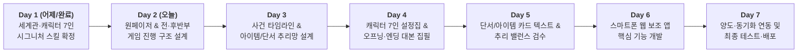

# 🗓️ 《옛날 옛적 뉴프론티어에서》 7일 완성 개발 플랜 (1-Week Roadmap)

> **목표**: 어제(Day 1) 진행한 핵심 설정 및 캐릭터 기획을 시작으로, **7일 안에 실제 오프라인 모임에서 스마트폰 웹 보조 앱과 함께 바로 플레이 가능한 완성본**을 제작합니다.

---

## 📊 일주일 전체 일정 한눈에 보기

---

## 📅 일자별 상세 과업 (Day 1 ~ Day 7)

### ✅ Day 1 (어제) : 세계관 구축 & 캐릭터·스킬 밸런스 확정 `[완료]`
* **타이틀 및 세계관 확정**: 《옛날 옛적 뉴프론티어에서》, 고립된 서부 마을 '뉴 프론티어'와 전임 보안관 행크 살해·암매장 사건.
* **캐릭터 7인 + NPC(행크) 서사 및 점수표 설계**:
  * 외지인 보안관 `클라이브`(12점 만점) vs 마을 공범 5인(`애니`, `베니`, `데이비드`, `어니스트`, `플로렌스`) + 단독 배신자 `그레이스`(각 10점 만점).
* **시그니처 대사형 특수 능력 & 우선순위 확립**:
  * 0순위 반응형(`그레이스` 1회 무적, `베니` 대리 희생) ➔ 1순위 제압/침묵(`클라이브` 리볼버, `애니` 스킬 봉쇄) ➔ 2순위 강탈(`데이비드` 1장 압수) ➔ 3순위 도주(`플로렌스` 왕진 이탈) ➔ 투표 가중(`어니스트` 2표).

---

### ✅ Day 2 (2일차) : 포맷 확정 & 전반부·중반·후반부 진행 구조 설계 `[완료]`
* **완료 항목**:
  * 전체 기획서 정합성 검토(배지 탐색 구조 등 수정 완료).
  * 파티게임즈(Group SNE) 오프라인 포맷 + 스마트폰 웹 보조 앱 방향성 확정.
  * 노스포일러 홍보문(`PROMO.md`) 및 1-Page 기획서(`ONE_PAGE_PROPOSAL.md`) 작성 완료.
  * **오프라인 타임테이블 확정**: `오프닝/자기소개` ➔ `1차 조사 및 대화·밀담` ➔ `★빈 무덤의 반전(2차 조사 직전)` ➔ `2차 조사 및 대화·밀담` ➔ `최종 투표 & 행크 생사 주사위 결판`.
  * **행크 추격전(막타 독점) 룰 확정**:
    * 사살·제압 4종 파츠(`콜트 리볼버`, `특수 탄약`, `올가미 밧줄`, `폐광 비밀 지도`) vs 생존 2종 파츠(`외과 봉합 키트`, `강철 방탄 조끼`) — 개당 주사위 `+1` 합산.
    * 개인별 `주사위(1~6) + 보유 아이템 보너스` 최고 눈금 1위 달성자 승리 (`클라이브` 1위 시 단독 +5점 / `애니·베니` 중 1위 시 공동 +3점 / `데이비드·어니스트·플로렌스` 각 1위 시 단독 +3점 / `그레이스` 1위 시 단독 +5점).

---

### ✅ Day 3 (3일차) : 7개 구역 설정 & 24장 아이템/단서 카드 설계 `[완료]`
* **어젯밤 행적 구성 방식 확정**:
  * 기계적인 분 단위 시간표(타임라인)를 배제하고, 캐릭터별로 **[어젯밤 내가 저지른 일]** 중심의 몰입형 서사로 구성 확정.
* **7개 조사 구역 및 24장 카드 앞/뒷면 텍스트 확정**:
  * **카드 뒷면 통일**: 모든 카드의 뒷면은 세부 힌트 없이 **해당 지역명**으로만 표기.
  * **핵심 목표 아이템 2종**: `[피 묻은 연방 보안관 배지]`(성당), `[어니스트 시장의 비리 장부]`(보안관 사무소).
  * **행크 사살·제압 4종 & 생존 2종 아이템(총 6종)**: 1차 조사(5개 구역 17장)와 2차 조사(신규 2개 구역: `빈 무덤` 3장, `외곽 폐광` 4장)에 균형 배치.
  * **추리 단서 카드(16장)**: 과도한 해설·정답 스포일러 문구를 제거하고 객관적 단서 중심으로 텍스트 다듬기 완료.

---

### ✅ Day 4 (4일차) : 오프닝·엔딩 및 캐릭터 7인 비밀 설정집 집필 `[완료]`
* **공통 시트 집필 (`STORY_SCRIPTS.md`)**:
  * 오프닝 나레이션 시트, 중반 `빈 무덤의 반전` 긴급 시트, 캐릭터 이니셜별 단독 멀티 엔딩 7종(`Ending A ~ G`) 및 진상 해설서 작성 완료.
  * 최종 점수 동점 시 `행크 추격전 주사위 1위` 인물 우선 승리 규칙 및 `애니 & 베니 공동 1등` 시 `Ending A + B` 연속 낭독 규칙 반영 완료.
* **7인 캐릭터 비밀 설정집(`CHARACTER_BOOKLETS.md`) 전문 작성**:
  * 플레이어가 자기 스마트폰으로 읽을 1인칭 시점 스토리, 어젯밤 내가 저지른 일, 승리 목표 점수표, 시그니처 능력 가이드 작성 완료.

---

### ✅ Day 5 (5일차) : 단서/아이템 카드 텍스트 완성 & 시나리오·밸런스 최종 검수 `[완료]`
* **7인 전원 밸런스 및 추격전 구도 확정**:
  * 데이비드·어니스트의 `+3점` 목표를 `[행크 제압]`으로 통일하여 7인 전원이 `행크 추격전(주사위 결판)`에 참전하도록 밸런스 패치 완료.
  * 생존파(`플로렌스` vs `그레이스`) 역시 주사위 1위 본인만 점수를 독점하도록 분리하여 생존파 쏠림 현상 해소.
  * 클라이브의 `+2점` 목표를 `[행크의 조력자(플로렌스/그레이스) 색출]`로 설정하여 생존파의 `+2점 은폐 목표`를 직접 저격·견제하는 메커니즘 구축.
  * 클라이브가 최종 투표로 유치장에 수감되더라도 주사위 **`4 이상(50%)`** 시 탈옥하여 추격전에 합류하는 규칙 반영 완료.

---

### 💻 Day 6 (6일차) : 스마트폰 웹 보조 앱(Web Companion) UI 및 기능 개발 `[완료]`
* **모바일 웹 화면 구축 (`Next.js + Tailwind CSS` / [`APP_DEV_PLAN.md`](./APP_DEV_PLAN.md))**:
  * 방 코드(`1889`) 입장, 6인/7인 모드 설정, 캐릭터 선택 및 실수 방지용 잠금(Lock) 화면.
  * **3대 스포일러 관문 비밀번호 해금 시스템**:
    * **🔒 관문 1 (`암호: 1889`)**: `5단계: ★빈 무덤의 반전` 대본 + 캐릭터별 히든 미션 + 2차 조사 구역(`빈 무덤`, `외곽 폐광`) 7장 해금.
    * **🔒 관문 2 (`암호: 0607`)**: `9단계: 1분 비밀 지목기(클라이브·그레이스)` + `11~12단계: 유치장 수감·클라이브 탈옥 주사위·행크 추격전 자동 합산기` 해금.
    * **🔒 관문 3 (`암호: 9999`)**: `13단계: 멀티 엔딩 북(Ending A~G / A+B 연속 낭독)` + 비밀 지목 자동 채점 + `사건의 전말 해설서` 해금.
  * **4대 핵심 탭 구현 (`src/components/*`)**:
    * **탭 1 `[📖 내 설정집]`**: 비밀 시트 뷰어, 목표 점수 계산기, **시그니처 대사 카드 전체화면 띄우기**, 클라이브 사법거래 회유서 연동.
    * **탭 2 `[🔍 단서 구역]`**: 7개 구역별 카드 목록(뒷면 지역명) 및 터치하여 내 소지품으로 독점 획득.
    * **탭 3 `[🎒 내 소지품]`**: 획득 카드 상세 보기, 내 추격전 보너스(`개당 +1`) 자동 계산, **다른 캐릭터에게 양도하기 UI**.
    * **탭 4 `[🎬 오프닝 & 결말]`**: 오프닝 및 3대 관문 암호 해금, 비밀 지목, 주사위 결판, 멀티 엔딩 뷰어.

---

### 🚀 Day 7 (7일차) : 실시간 상태 동기화 & 모바일 테스트 및 배포 `[완료]`
* **플레이어 간 실시간 연동 (`/api/room`)**:
  * 6~7명이 각자 폰으로 같은 방 코드(`1889`)에 접속했을 때 카드 독점 획득 상태, 아이템 양도 내역, 클라이브 사법거래 회유서, 3대 관문 암호 해금, 비밀 지목 및 추격전 주사위가 실시간으로 공유되도록 연동 완료.
* **프로덕션 빌드 검증 완료**:
  * TypeScript 타입 검증 및 Next.js 프로덕션 빌드(`npm run build`) 통과 완료.
