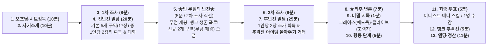
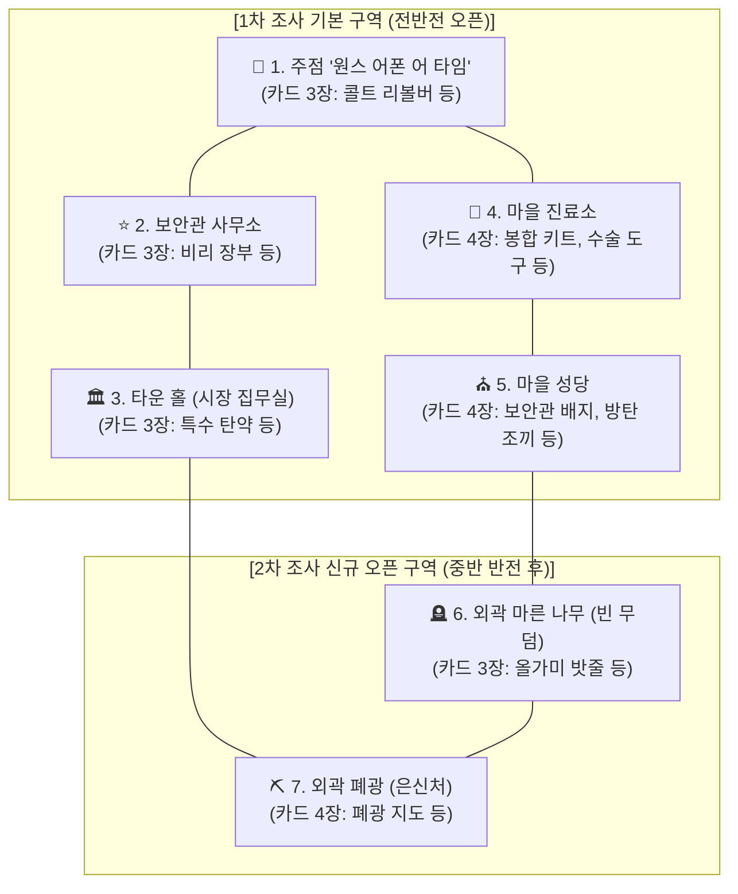

# 🏜️ 옛날 옛적 뉴프론티어에서

## 1. 개요
* **장르**: 1 vs 다수 비대칭 심리 추리 머더 미스터리 웹 게임 (서부극 누아르)
* **플레이 인원**: 6~7인 (외지인 보안관 1명 + 마을 주민 5~6명)
* **핵심 콘셉트**:
  * 모래폭풍과 혹한으로 고립된 서부 개척 마을 **'뉴 프론티어(New Frontier)'**에 실종된 전임 보안관을 찾으러 온 **외지인 보안관 '클라이브(Clive)'**.
  * 각자의 죄와 비밀을 감추기 위해 전임 보안관 행크를 살해·암매장하고 입을 맞춘 **마을 사람들 5~6명**.
  * 하지만 클라이브에게는 아무도 모르는 치명적인 진짜 목적이 숨겨져 있으며, 중반부(2차 조사 시작 직전)에는 묻어버렸던 무덤이 비어있는 충격적 진실이 드러난다.

---

## 2. 핵심 인물: 외지인 보안관 '클라이브 (Clive)'

> *"난 법을 지키러 온 게 아니야. 그 자식이 진짜 숨이 끊어졌는지, 그리고 그놈의 뱃지가 어디 있는지만 알면 돼."*

### 2.1. 캐릭터 프로필
* **이름**: 클라이브 (Clive)
* **표면적 신분**: 연방 정부에서 파견된 베테랑 수사관 / 보안관
* **전투력**: **1대 1 결투로는 절대 이길 수 없는 전설적인 총잡이**
  * 주민들은 물리적으로 클라이브를 죽이거나 쫓아낼 수 없으며, 오직 '거짓말과 심리전'으로만 상대해야 합니다.

### 2.2. 숨겨진 진짜 정체 (플레이어 본인만 아는 비밀)
* 과거 서부를 공포에 떨게 했던 악명 높은 **무법자 갱단의 일원**.
* 과거 자신의 갱단 동료들을 제 손으로 전부 몰살하고 배신한 뒤, 보안관 행세를 하며 새로운 삶(합법적 신분 세탁)을 살고 있습니다.
* 그러나 당시 참극의 **유일한 생존자**이자 클라이브의 정체를 알고 있는 인물이 바로 이 마을로 도망쳐 보안관 노릇을 하던 **'전임 보안관'**입니다.

### 2.3. 클라이브의 승리 목표 & 점수표 (총 12점 만점)

*1 vs 다수 구도의 높은 난이도를 반영하여, 숨겨진 미션 달성 시 최고 12점까지 획득 가능.*

| 점수 | 승리 목표 (Objectives) | 달성 조건 및 팁 |
| :---: | :--- | :--- |
| **+5점** | **행크의 배지를 찾는다** | 행크가 마을 어딘가에 숨겨둔 **[피 묻은 연방 보안관 배지]**를 찾아내 게임 종료 시 손에 넣어야 합니다. |
| **+2점** | **행크의 조력자를 찾아낸다** | 이 마을 안에서 행크를 몰래 돕고 있는 조력자(**플로렌스** 또는 **그레이스**)를 찾아내 지목합니다. *(※ 지목에 성공하면 클라이브가 **`+2점`**을 얻고, **지목당한 그레이스 또는 플로렌스의 `+2점 은폐 목표`를 실패(`0점`)**시켜 생존파를 견제할 수 있습니다!)* |
| **+5점** | **[히든 미션] 행크를 사살한다** | 중반 반전(2차 조사 직전)에서 행크가 살아있음(빈 무덤)이 밝혀지면 해금되는 비밀 조건. **행크를 찾아내 내 손으로 직접 숨통을 끊어야 합니다.** |

### 2.4. 클라이브의 특권 & 인게임 스킬
* **`"석양이 진다..."` [리볼버: 총구 겨누기] (물리적 무기)**:
  * 1대 1 결투 불패의 위압감으로 마을 사람들의 무력 반발을 원천 봉쇄.
  * 행동 단계 선언 ➔ 이어지는 투표 단계에서 지목 대상 1명의 **[투표권 완전 박탈 (투표 불가 / 0표 처리)]** 및 도주 차단.
* **`"난 뱃지만 찾으면 그만이야"` [사법거래 회유서] (정치적 무기)**:
  * 1:1 밀담에서 주민 1명에게 면책을 약속하며 **자신의 조력자로 포섭(매수)**.
  * **★매수된 주민의 승리 목표 변경**: 회유서를 수락한 주민의 기존 5점 목표(`내가 범인으로 지목되지 않는다`)가 **`[클라이브가 행크 사살 시 (+5점)]`**로 영구 대체됩니다! (※ 클라이브가 직접 행크를 사살하는 데 성공하면, 매수된 주민 본인이 최종 투표에서 유치장에 수감되더라도 +5점을 온전히 획득함. 반대로 클라이브가 사살에 실패하면 0점 처리)

---

## 3. 핵심 사건의 진실: "빈 무덤 (The Empty Grave)"

> *"우린 분명 그놈을 묻었습니다... 그런데 왜 무덤 속에 아무것도 없는 겁니까?!"*

* **사건의 전말**:
  * 마을 주민들은 전임 보안관의 횡포를 견디다 못해 약을 먹이고 린치한 뒤, 마지막으로 칼을 찔러 넣었습니다.
  * 폭풍이 몰아치던 밤, 마을 외곽 마른 나무 밑에 깊게 구덩이를 파고 암매장했습니다.
* **거대한 반전 (2차 조사 시작 직전 트리거)**:
  * 수사와 추궁이 이어지던 정오 무렵, 마을 북쪽 외곽 마른 나무 아래의 무덤이 발견되어 파헤쳐지지만, **무덤 안에는 시신이 없습니다.**
  * 흙벽 안쪽을 손톱으로 피투성이가 되도록 긁어내며 **산 채로 기어 나온 흔적**만 남아있을 뿐입니다.
* **파생되는 공포 & 게임의 급변**:
  * **주민들의 멘붕**: 전임 보안관이 복수를 위해 마을 어딘가에 숨어 자신들을 노리고 있다는 공포.
  * **클라이브의 초조함**: 전임 보안관이 주민들에게 자신의 과거(갱단 배신자)를 폭로하기 전에, 부상당해 마을 어딘가에 숨어있는 그놈을 먼저 찾아내 제거해야 하는 시간제한 발생.

---

## 4. 플레이어블 캐릭터 상세 시트

> *(※ 외부인 보안관 **클라이브(Clive)**의 상세 시트는 상단 [2. 핵심 인물] 섹션 참조)*

---

### [마을 주민 1] 마담 애니 (Annie) - 주점 사장

> *"외롭고 슬퍼 보였던 당신의 눈빛을 사랑했어요. 하지만... 내 숨통을 조르던 당신의 손을 용서할 순 없어."*

* **직업 / 겉모습**: 
  * 뉴 프론티어 마을의 최고 명소, 주점 **'원스 어폰 어 타임 (Once Upon a Time)'**의 사장.
  * 마을에서 가장 아름다운 미녀이자 뛰어난 사교술을 지닌 여장부.
* **전임 보안관과의 관계**: 
  * 겉으로는 행크가 주점을 보호해 주는 관계였지만, **실은 연인 관계**였음.
  * 산전수전을 다 겪은 거친 남자이지만 고독하고 슬픈 눈빛에 매료되었음.
  * 그러나 술만 마시면 이상한 소리를 지껄이며 극도로 난폭해졌고, 애니를 향한 무자비한 구타와 폭력이 시작됨.
* **범행에서의 역할 (주동자 / 최종 칼 가해자)**:
  * 마당발 인맥으로 행크에게 원한을 가진 공모자들(베니, 데이비드, 어니스트, 플로렌스)을 모아 살해 모의를 주도.
  * 플로렌스에게 받은 수면제를 위스키에 타 행크에게 먹이고, 베니가 잠든 행크를 마을 외곽으로 운반.
  * 공모자들과 함께 멍석말이 구타를 가한 뒤, **마지막으로 애니가 직접 행크에게 칼을 찔러 치명상을 입힘.**
  * 함께 6피트 아래 구덩이에 그를 암매장함.
* **애니의 승리 목표 & 점수표 (총 10점 만점)**:
  * **+5점**: **내가 최종 범인(주동자)으로 지목되지 않는다.** (자신의 무죄를 지켜냄)
  * **+2점**: **베니가 범인으로 지목받지 않는다.** ("나 때문에 손에 피를 묻힌 불쌍한 베니만큼은 절대 교수형대에 세우지 않겠다.")
  * **+3점**: **[히든 미션] 행크를 죽인다.** (빈 무덤이 밝혀지고 행크가 살아있음이 드러나면 해금. 그 악마가 보복하러 오기 전에 이번엔 내 손으로 확실히 죽여야 함.)
* **시그니처 아이템 & 특수 능력**:
  * **`"그저 깊은 잠이 필요했을 뿐..."` [라벨 뜯긴 수면제 약병]**:  
    * **효과 [스킬 봉쇄 (행동 1순위)]**: 행동 단계에서 플레이어 1명을 지목해 수면제를 먹여, **해당 라운드 동안 대상이 자신의 특수 능력을 아예 사용하지 못하게(침묵/무력화)** 만듦.

---

### [마을 주민 2] 피아니스트 베니 (Benny) - 살롱 연주자

> *"난 상관없어요. 교수형 밧줄이 내 목을 조여온다 해도... 애니, 당신이 다시 웃을 수만 있다면."*

* **직업 / 겉모습**: 
  * 주점 '원스 어폰 어 타임'의 간판 피아니스트.
  * 곱상한 외모에 다정하고 재치가 넘쳐, 마을 사람들과 손님들에게 인기가 높은 엔터테이너.
* **전임 보안관과의 갈등 & 동기**: 
  * 사장인 아름다운 애니와 가까워지며 호감을 품었으나, 행크의 거칠고 고독한 매력에 빠져든 애니를 보며 절망하고 마음을 접으려 했음.
  * 그러나 주점 2층에서 행크가 애니를 무자비하게 구타하는 소리를 듣게 됨.
  * 연약한 자신이 베테랑 총잡이 행크에게 맞설 수 없어 피눈물을 흘리던 중, 애니로부터 "행크를 제거하자"는 은밀한 요청을 받음.
* **범행에서의 역할 (운반책 & 공모자)**:
  * 수면제를 먹고 곯아떨어진 행크를 마차로 마을 외곽까지 운반함.
  * 마을 외곽에 모인 5명(베니, 애니, 데이비드, 어니스트, 플로렌스)과 함께 행크를 멍석말이 구타하고, 마지막으로 애니가 칼을 꽂은 뒤 6피트 아래에 암매장함.
* **베니의 승리 목표 & 점수표 (총 10점 만점)**:
  * **+2점**: 애니가 범인으로 지목당하지 않는다.
  * **+5점**: **위험으로부터 애니를 지킨다** (투표 위협으로부터 애니를 지켜냄. 대신 희생해도 달성!).
  * **+3점**: **[히든 미션] 행크를 죽인다** (빈 무덤이 밝혀진 후, 살아 돌아온 행크가 애니에게 보복하지 못하도록 내 손으로 처단).
* **시그니처 아이템 & 특수 능력**:
  * **`"Annie, are you OK? (괜찮아요, 애니?)"` [품속 틴케이스 (애니의 손수건 & 멍 연고)]**:  
    * **효과 [대리 희생: 투표 흡수 (투표 단계 전용)]**: 최종 투표 단계에서 애니가 지목/최다 득표 타깃이 될 때 즉시 개입하여, **애니가 받을 표를 베니 자신이 대신 흡수하여 체포(유치장 수감)**됨.

---

### [마을 주민 3] 부관 데이비드 (David) - 마을 부보안관

> *"이 배지는 당신 같은 사기꾼의 가슴에 달릴 물건이 아니야. 내 아버지의 피가 묻은, 우리 가문의 명예다."*

* **직업 / 신분**: 
  * 뉴 프론티어 마을 보안관 사무소의 부관(Deputy). 
  * 선대 보안관이었던 영웅 아버지를 쏙 빼닮아 주민들의 신뢰를 받는 성실하고 과묵한 청년.
* **전임 보안관과의 악연 (범행 동기)**: 
  * 3년 전, 마을의 초대 보안관이었던 아버지가 사막 순찰 중 뒤통수를 가격당하고 낙마 사고로 위장되어 의문의 죽음을 맞이함.
  * 직후 행크가 아버지의 연방 배지를 차고 나타나 후임 보안관 자리를 꿰참.
  * 아버지의 일기장 메모와 미완성 부검 기록을 근거로 **"행크가 아버지를 암살하고 배지를 빼앗았다"**고 확신, 진실을 밝히기 위해 행크 밑에서 모욕을 견디며 부관으로 일해 옴.
* **범행에서의 역할 (치명타 가담자)**:
  * 마담 애니의 살해 제안에 망설임 없이 동참.
  * 마을 외곽 구덩이 앞에서 행크를 멍석말이할 때, 아버지의 원수를 갚기 위해 **자신의 윈체스터 라이플 개머리판으로 행크의 머리를 무자비하게 가격해 치명상**을 입힘.
  * 쓰러진 행크의 품속을 뒤져 아버지의 유품인 **[피 묻은 연방 보안관 배지]**를 되찾으려 했으나, **행크의 옷 어디에도 배지가 없었음!** (행크가 이미 마을 어딘가에 숨겨둔 상태).
  * 마지막으로 애니가 칼을 꽂고 6피트 아래에 암매장한 뒤, 날이 밝자마자 배지를 찾으려 했으나 외지에서 보안관 행세를 하는 '클라이브'가 마을에 도착해 수사를 시작함.
  * **당신은 절대로 범인으로 지목당하면 안 됩니다. 범인으로 체포당하기 전에 공범들과 힘을 합쳐 수사망을 피하고, 행크가 마을 어딘가에 숨겨둔 아버지의 배지를 반드시 되찾아야 합니다.**
* **데이비드의 승리 목표 & 점수표 (총 10점 만점)**:
  * **+5점**: **내가 범인(공범)으로 지목받지 않는다.** (무죄와 부관 직위를 지켜냄)
  * **+2점**: **아버지의 배지를 찾아내 끝까지 소유한다.** (마을 어딘가에 숨겨진 `[피 묻은 연방 보안관 배지]`를 찾아내거나 압수하여, 게임 종료 시 내 손에 넣음)
  * **+3점**: **[히든 미션] 행크를 제압한다.** (빈 무덤이 밝혀진 후, 행크 추격전에서 주사위 1위를 달성해 행크를 직접 제압·체포함)
* **시그니처 아이템 & 특수 능력**:
  * **`"내가 보안관의 후계자다"` [부보안관의 수갑 & 체포 영장]**:  
    * **효과 [증거품 1장 압수 (행동 2순위)]**: 부보안관의 공권력을 발동하여, 지목한 플레이어 1명이 소지한 **일반 아이템/단서(특수능력 카드 제외) 중 1장을 압수**해 가져옴. *(클라이브나 다른 주민이 먼저 배지를 찾아냈더라도 이 능력으로 합법적 압수·회수 가능!)*

---

### [마을 주민 4] 마을 시장 어니스트 (Ernest) - 부패한 행정 수반

> *"뉴 프론티어 마을은 내 전부고, 내가 없으면 이 마을은 안 돼! 무슨 수를 써서라도 살아남아야 한다."*

* **직업 / 신분**: 
  * 뉴 프론티어 마을의 부패한 시장(Mayor). 말끔한 양복을 입고 근엄한 척하지만 권력욕과 자기합리화로 가득 찬 인물.
* **전임 보안관과의 유착 & 갈등 (범행 동기)**: 
  * 원래 행크와 유착 관계였으며, 주로 행크가 어니스트의 더러운 일들을 뒤에서 처리해 주는 하수인 역할이었음.
  * 그러나 어느 날 어니스트의 금고가 털려 치명적인 **[비리 장부 (철도 부지 매각 이중 장부)]**를 도난당했고, 그것을 행크가 손에 넣게 됨.
  * 행크가 비리 장부를 무기로 어니스트를 협박하기 시작하면서 오히려 시장인 어니스트가 행크의 부하처럼 상납하며 끌려다니는 신세가 됨.
  * 그러던 와중 마담 애니가 은밀하게 행크를 처리하자고 제안하자, 이를 절호의 기회로 여기고 가담함.
* **범행에서의 역할 (토지 제공 & 구타 가담)**:
  * 시신을 암매장할 **마을 외곽의 사유지(폐광 토지)를 제공**했고, 현장에서 공모자들과 함께 직접 구타에 참여함.
  * 마지막으로 애니가 칼을 꽂고 6피트 아래에 묻자 *'이제 행크가 숨겨둔 비리 장부만 되찾으면 된다'*고 안도했으나, 행크의 실종 소식을 듣고 외지인 보안관 클라이브가 찾아옴.
* **어니스트의 승리 목표 & 점수표 (총 10점 만점)**:
  * **+5점**: **범인으로 지목되지 않는다.** (무슨 수를 써서라도 살아남아 시장직을 유지함)
  * **+2점**: **비리 장부를 회수한다.** (행크가 마을 어딘가에 숨겨둔 자신의 `[비리 장부]`를 되찾아 게임 종료 시 내 손에 넣음)
  * **+3점**: **[히든 미션] 행크를 제압한다.** (빈 무덤이 밝혀진 후, 행크 추격전에서 주사위 1위를 달성해 내 비리를 아는 행크를 직접 제압·처리함)
* **시그니처 아이템 & 특수 능력**:
  * **`"친애하는 뉴 프론티어 마을 여러분!"` [시장의 연설문 & 약속어음]**:  
    * **효과 [시장의 선동: 투표 2표 (투표 단계 전용)]**: 최종 투표 단계에서 선언하여 **어니스트가 행사하는 투표권이 [2표]로 계산됨.**  
    *(인게임 심리전: 만약 다른 플레이어가 먼저 [비리 장부]를 주우면, 장부를 빌미로 어니스트를 협박하여 그의 2표 스킬을 조종하는 '제2의 행크' 구도가 펼쳐짐!)*

---

### [마을 주민 5] 여의사 플로렌스 (Dr. Florence) - 마을 진료소 의사 (강제 배신자)

> *"난 분명 그 악마를 죽여서 묻었어요... 그런데 새벽에 피투성이가 된 그놈이 내 진료소 문을 열고 들어와 총구를 겨눴다고요!"*

* **직업 / 신분**: 
  * 뉴 프론티어 마을의 유일한 의사이자 약사. 차분하고 상냥한 선생님으로 존경받지만 어두운 비밀을 품고 있음.
* **전임 보안관과의 악연 (범행 동기)**: 
  * 처음엔 치료 목적으로 모르핀을 썼으나 점점 사용량이 과해져 **과잉 진료로 환자들을 중독시키고 모르핀을 불법 판매**하게 됨.
  * 이를 행크에게 들켜 모르핀을 상납하게 되었고, 갈수록 상납량이 폭증해 재정이 파탄 나자 행크는 과잉 진료를 빌미로 협박을 일삼음.
* **사건 당일 밤과 '새벽의 공포' (강제 배신자가 된 이유)**:
  1. **살해 공모 가담**: 애니가 행크를 제거하자고 제안하자, 플로렌스는 진심으로 행크가 죽길 바라며 **치사량의 고농도 모르핀계 수면 마취제**를 건네고 함께 구타한 뒤 6피트 아래에 묻음.
  2. **모르핀 내성의 기적**: 하지만 수년간 플로렌스에게서 뺏은 모르핀을 매일 투약해 온 행크는 **초고도 약물 내성** 덕분에 죽지 않고 심박수만 느려진 **'가사 상태'**에 빠졌다가 땅속에서 깨어나 스스로 기어 나옴.
  3. **새벽 3시의 협박**: 그날 새벽, 피와 진흙 범벅이 된 행크가 제 발로 플로렌스의 진료소에 쳐들어와 총구를 겨눔:  
     *"네년이 준 약에서 살아 돌아왔다. 당장 내 상처를 꿰매라! 내가 죽으면 내 부하가 네년의 [과잉진료 치부책]을 즉시 연방 법원에 넘기도록 손을 써뒀다. 네가 살길은 놈들에게 내 생존을 숨기고, 내가 회복해 마을을 빠져나갈 때까지 날 치료하고 살려내는 것뿐이다!"*
  4. **현재 상태**: 플로렌스는 덜덜 떨며 행크를 응급 봉합해 은신처로 숨겼음. 아침이 밝자 다른 공범들은 행크가 죽은 줄 알고 있지만, **플로렌스 혼자만 행크가 살아있음을 알고 있으며, 살기 위해 공범들을 배신하고 행크를 끝까지 생존시켜야만 하는 처지**가 됨.
* **플로렌스의 승리 목표 & 점수표 (총 10점 만점)**:
  * **+5점**: **범인(또는 배신자)으로 지목당하지 않는다.** (최종 투표에서 최다 득표를 피하고 살아남음)
  * **+2점**: **행크를 치료해 준 조력자임을 들키지 않는다.** (`[최후 변론]` 직후 1분 비밀 지목 단계에서 클라이브가 '행크의 조력자'로 플로렌스를 지목하지 못하면 달성! 지목당하면 0점)
  * **+3점**: **[히든 미션] 내 손으로 행크를 살려낸다.** (행크 추격전에서 플로렌스가 주사위 1위를 달성해 행크를 직접 구출·도주시킴)
* **시그니처 아이템 & 특수 능력**:
  * **`"응급 환자가 생겼어요. 먼저 가보죠"` [의사의 왕진 가방]**:  
    * **효과 [응급 왕진 도주 (행동 3순위)]**: 투표 단계에서 현장을 빠져나가 **피투표 대상(용의자 후보)에서 완전히 제외**됨.
    * **우선순위 제약**: 행동 단계 **3순위(가장 마지막)**에 발동하므로, 1순위인 클라이브의 리볼버(`"석양이 진다..."`)나 애니의 수면제(`"그저 깊은 잠이..."`)에 먼저 지목당했다면 도주하지 못하고 불발됨.

---

### [7인 추가 캐릭터] 그레이스 수녀 (Sister Grace) - 전임 보안관 행크의 딸

> *"아버지가 악마라 해도... 죽어서 지옥에 가선 안 돼요. 살아서 신 앞에 무릎 꿇고 참회해야만 합니다."*

* **직업 / 신분**: 
  * 뉴 프론티어 마을 외곽 낡은 목조 성당의 젊은 수녀.
  * 거친 무법자 마을에서 유일하게 주민들의 존경과 위안을 받는 순결과 자비의 상징.
* **아버지(행크)와의 서사 & 신념**: 
  * 어릴 적 어머니가 죽은 뒤 아버지가 무법자가 되어 집을 나갔고, 오랫동안 떨어져 지내며 교회의 수녀원에서 맡겨져 자람.
  * 마을에서 다시 만난 아버지가 여전히 범죄를 저지르자, 아버지가 더 이상 죄를 짓지 않고 **자신의 실체를 밝혀 정당한 죗값을 치르고 회개하기를** 진심으로 바람.
  * 항상 아버지는 무엇인가에 쫓기는 듯했음.
* **살인 사건과의 관계**: 
  * **살인 공모에서 배제된 유일한 인물 (뱅의 배신자/Renegade 포지션)**.
* **그레이스의 승리 목표 & 점수표 (총 10점 만점)**:
  * **+5점**: **내 손으로 아버지(행크)를 살려낸다.** (행크 추격전에서 그레이스가 주사위 1위를 달성해 아버지를 직접 구출함)
  * **+2점**: **행크의 친딸(조력자)임을 들키지 않는다.** (`[최후 변론]` 직후 1분 비밀 지목 단계에서 클라이브가 '행크의 조력자'로 그레이스를 지목하지 못하면 달성! 지목당하면 0점)
  * **+3점**: **매드독을 찾아낸다.** (마을 사람들 중 누가 진짜 '매드독'인지 정체를 추리해 `[최후 변론]` 직후 1분 비밀 지목 단계에 지목하여 찾아냄)
* **시그니처 아이템 & 특수 능력**:
  * **`"주께서 저를 지키시나이다"` [은빛 십자가 성경책]**:  
    * **효과 [신성한 가호: 자신 무적 (반응형 선택 발동)]**: 그레이스가 적대적 특수 능력(클라이브의 리볼버, 애니의 수면제, 데이비드의 아이템 압수 등)의 **타깃이 되었을 때, 사용 여부를 선택하여 그 스킬을 1회 완전히 무효화(불발)**시킴.

---

### [핵심 NPC] 전임 보안관 행크 (Sheriff Hank) - Non-Playable

> *"네놈들이 날 묻었다고 생각했겠지... 내 목을 비틀지 못한 걸 평생 피눈물로 후회하게 만들어주마."*

* **신분 / 성격**: 
  * 뉴 프론티어 마을의 전임 보안관이자 과거 악명 높은 '매드독 갱단' 출신의 유일한 생존자.
  * 탐욕스럽고 잔인하며, 마을 사람 모두에게 지울 수 없는 고통과 원한을 남긴 악마 같은 인물.
* **인물 간의 악연 관계 총정리**:
  * **A (애니)**: 내연녀로 삼고 상습적인 구타와 폭력을 일삼음.
  * **B (베니)**: 폭력을 행사할 때마다 비명을 감추기 위해 피아노를 치라고 강요함.
  * **C (클라이브)**: 과거 자신의 갱단을 몰살하고 배신한 옛 동료 (클라이브의 정체를 아는 유일한 인물).
  * **D (데이비드)**: 선대 보안관이었던 데이비드의 아버지를 암살하고 배지를 꿰찬 의혹.
  * **E (어니스트)**: 횡령 비리 문서를 빌미로 마을 금고와 재산을 갈취함.
  * **F (플로렌스)**: 진료소의 모르핀을 강제로 빼앗고 착취함.
  * **G (그레이스)**: 유일하게 피를 나눈 친딸 (성당의 수녀).
* **사건의 전말 & 인게임 작동 (Game Trigger)**:
  * 마을 주민들의 공모로 수면제를 먹고 린치를 당한 뒤 외곽 구덩이에 생매장됨.
  * 그러나 질긴 생명력으로 흙벽을 긁어내며 **산 채로 기어 나와 탈출(빈 무덤의 진실)**.
  * 부상당한 몸을 이끌고 마을 어딘가(성당 지하실/폐광/살롱 뒤편)에 숨어 복수를 준비하고 있음.
  * **게임의 최종 분기점**: 클라이브, 주민들, 그레이스 수녀 중 **"누가 숨어있는 행크를 가장 먼저 찾아내는가?"**에 따라 최종 엔딩이 결정됨.

---

## 5. 역할 구성 및 시그니처 액티브 특수 능력 (A ~ H)

> **핵심 규칙**: 외지인 보안관 클라이브만 **2개의 권한 무기**를 가지며, 마을 주민들은 각자 자신의 목숨줄과 같은 **단 1개의 고유 액티브 특수 능력 카드**를 가집니다.  
> **발동 단계 구분**:
> * **`[행동 단계]` 발동 (조사 및 밀담이 모두 끝난 직후 열리는 별도 단계)**: **클라이브(`리볼버`)**, **애니(`수면제`)**, **데이비드(`1장 압수`)**, **플로렌스(`왕진 도주`)**, **그레이스(`반응형 무적`)** *(※ 클라이브의 `회유서`는 1:1 밀담 또는 행동 단계에서 사용)*
> * **`[투표 단계]` 전용 발동**: 오직 **어니스트(`2표 행사`)**와 **베니(`애니 대리 희생`)** 두 명만 **[투표 단계]**에서 자신의 특수 능력을 사용할 수 있습니다! *(단, 앞선 행동 단계에서 애니의 수면제에 찍혔다면 투표 단계에서도 스킬 사용 불가)*

| 이니셜 | 캐릭터명 | 발동 단계 / 순위 | 시그니처 대사 (카드명) | 인게임 액티브 특수 능력 (Special Ability) |
| :---: | :--- | :---: | :--- | :--- |
| **C** | **클라이브 (Clive)** | **행동 단계 (1순위)** 1:1 밀담 | 1. **`"석양이 진다..."`** 2. **`"난 뱃지만 찾으면 그만이야"`** | 1. **[리볼버 (행동 1순위)]** 지목 대상 1명의 **투표권 완전 박탈** 및 도주 차단 2. **[회유서]** 1:1 밀담에서 주민 1명에게 면책권을 주고 **조력자로 포섭(매수)**. 수락한 주민의 5점 목표는 **`[클라이브가 행크 사살 시 (+5점)]`**로 변경됨 |
| **A** | **애니 (Annie)** | **행동 단계 (1순위)** | **`"그저 깊은 잠이 필요했을 뿐..."`** | **[스킬 봉쇄 (행동 1순위)]** 행동 단계에서 지목한 **상대 1명의 특수 능력을 못 쓰게 만듦 (침묵/무력화)** |
| **D** | **데이비드 (David)** | **행동 단계 (2순위)** | **`"내가 보안관의 후계자다"`** | **[증거품 1장 압수 (행동 2순위)]** 행동 단계에서 대상 1명이 소지한 **일반 아이템/단서 중 1장을 압수**해 가져옴 |
| **F** | **플로렌스 (Florence)** | **행동 단계 (3순위)** | **`"응급 환자가 생겼어요. 먼저 가보죠"`** | **[응급 왕진 도주 (행동 3순위)]** 이어지는 투표 단계에서 빠져 용의자 후보에서 제외됨 *(단, 1순위에 먼저 찍히면 불발)* |
| **G** | **그레이스 (Grace)** | **행동 단계 (0순위 반응)** | **`"주께서 저를 지키시나이다"`** | **[자신 무적 (반응형 선택)]** 행동 단계에서 자신이 적대적 스킬에 공격당했을 때, **사용을 선택해 그 스킬을 1회 무효화** |
| **E** | **어니스트 (Ernest)** | **★투표 단계 전용** | **`"친애하는 뉴 프론티어 마을 여러분!"`** | **[시장의 선동 (투표 2표)]** 투표 단계에서 선언하여 어니스트가 행사하는 **투표권이 [2표]로 계산됨** |
| **B** | **베니 (Benny)** | **★투표 단계 전용** | **`"Annie, are you OK?"`** | **[대리 희생 (투표 흡수)]** 투표 단계에서 애니가 지목/최다 득표 타깃이 될 때, **자신이 대신 표를 흡수하여 체포됨** |
| **H** | **행크 (Sheriff Hank)** | NPC (추격 대상) | **`"네놈들이 날 묻었다고 생각했겠지..."`** | **[빈 무덤의 악마]** 생매장에서 탈출하여 어둠 속에 숨어있는 핵심 추적 목표 |

---

## 6. 오프라인 게임 진행 타임테이블 (총 120분) & 클라이맥스 구조

전체 게임은 2시간(120분) 코스로 구성되며, **`[최후 변론]`**을 듣고 난 직후 **`[비밀 지목 (1분)] ➔ [행동 단계] ➔ [최종 투표 단계] ➔ [행크 추격전(주사위 결판)]`**으로 이어지는 클라이맥스 구조를 가집니다.

| 순서 | 단계명 | 시간 | 핵심 진행 내용 |
| :---: | :--- | :---: | :--- |
| **1** | **오프닝 & 설정집 정독** | **10분** | 공통 도입부 낭독 후 스마트폰으로 개인 비밀 설정집 정독 |
| **2** | **자기소개 & 1차 발언** | **10분** | 7명이 돌아가며 1인당 1분씩 기본 신분 및 어젯밤 행적 소개 |
| **3** | **1차 조사 (전반전)** | **8분** | **`[암호: 0301]` 해금!** 기본 5개 구역(17장)에서 **클라이브부터 스네이크 순서(1장씩 2바퀴)**로 1인당 2장씩 획득 *(1바퀴째 본인 구역 선택 불가)* |
| **4** | **전반전 대화 & 1:1 밀담** | **20분** | 광장 토론 및 1:1 밀담, 단서 공유 및 은폐 |
| **5** | **★중반 이벤트: 빈 무덤의 반전** | **5분** | **`[암호: 1889]` 해금!** 2차 조사 직전 행크 생존 폭로 & 히든 미션·신규 구역 오픈 |
| **6** | **2차 조사 (후반전)** | **8분** | 신규 구역(`무덤`, `폐광` 7장) + 1차 잔여 카드(3장) 중 **그레이스(6인 시 플로렌스)부터 역순**으로 획득 |
| **7** | **후반전 밀담 & 아이템 몰아주기** | **25분** | **핵심 심리전!** 사살·제압 4종 / 생존 2종 파츠 양도, 배지·장부 거래, 회유서 포섭 |
| **8** | **★최후 변론 (광장 발언)** | **7분** | 행동 단계 돌입 전, 1인당 1분씩 최후의 호소 및 의심자 지목 발언 |
| **9** | **★그레이스·클라이브 비밀 지목** | **1분** | **최후 변론 직후(행동 단계 전)!** 그레이스는 `매드독`을, 클라이브는 `행크의 조력자`를 비공개 지목 |
| **10** | **행동 단계 (별도 진행)** | **5분** | 최후 변론을 바탕으로 **0~3순위 행동 스킬**(리볼버/수면제/압수/도주/무적) 발동 |
| **11** | **최종 투표 단계** | **5분** | **어니스트(2표)·베니(대리 희생)** 전용 스킬 발동 ➔ **최다 득표자 1명 유치장 수감!** |
| **12** | **행크 추격전 (주사위 결판)** | **5분** | 수감되지 않은 자유인만 참여! `주사위(1~6) + 전용 아이템 보너스` 최고 눈금 1위 결판 |
| **13** | **엔딩 낭독 & 점수 정산** | **11분** | 멀티 엔딩 대본 낭독 + 사건 진상 해설 + 개인별 점수 합산 및 우승자 발표 |
| **합계** | **총 플레이 타임** | **120분** | **(정확히 2시간 코스)** |

---

### 6.1. 클라이맥스 연결 규칙: `[최후 변론] ➔ [비밀 지목] ➔ [행동 단계] ➔ [투표 단계] ➔ [행크 추격전]`

> **🚨 핵심 연결 규칙 (유치장 수감 효과 & 클라이브 탈옥 판정)**:  
> * **`[투표 단계]`에서 최다 득표로 지목된 최종 범인(1명)은 즉시 수갑을 차고 유치장에 수감되므로, 뒤이어 열리는 `[행크 추격전(주사위 결판)]`에 참여할 수 없습니다!** *(보유하고 있던 사살/생존 아이템도 쓸 수 없게 됨)*  
> * **🎲 클라이브 탈옥 판정 (`4 이상` 성공)**: 단, 외지인 총잡이 **클라이브**가 최다 득표로 유치장에 수감되었을 경우, 추격전 시작 직전 **6면체 주사위를 굴려 `4 이상(4, 5, 6 / 확률 50%)`이 나오면 유치장을 탈출하여 `[행크 추격전]`에 정상 참여**할 수 있습니다! *(1~3이 나오면 탈옥 실패)*

이 연결 규칙을 통해 각 캐릭터의 고유 특수 능력이 투표와 행크 추격전 양쪽에 결정적인 영향을 미칩니다:
1. **베니의 `"Annie, are you OK?"` (투표 단계 - 대리 체포 희생)**: 아이템을 몰아 가진 애니가 투표에서 최다 득표로 체포될 위기에 처했을 때, **베니가 대신 감옥에 들어가고 자유의 몸이 된 애니가 행크 추격전에 참가**할 수 있습니다.
2. **플로렌스의 `"응급 환자가 생겼어요. 먼저 가보죠"` (행동 단계 3순위 - 투표 후보 이탈)**: 최후 변론에서 몰표 위기를 감지하면 행동 단계에서 왕진 도주를 선언하여, 투표에서 감옥에 갇히는 일을 원천 방지하고 **안전하게 행크 구출 주사위를 굴릴 수 있습니다.**
3. **클라이브(`행동 1순위: 리볼버 0표`) & 어니스트(`투표 전용: 2표 선동`)**: 투표 판세를 조작해 **아이템을 많이 모은 경쟁자(에이스)를 감옥에 쳐넣어 행크 추격전에서 탈락**시킬 수 있습니다.

---

### 6.2. 행크 추격전: [전용 아이템 수집(개당 +1) + 개인별 주사위 최고 눈금(막타 독점)] 시스템

`투표 단계`에서 수감되지 않은 플레이어들 중 행크 추적(사살 또는 구출)을 원하는 플레이어들이 참여하여 **주사위 + 아이템 합산 대결**을 펼칩니다.

#### ① 기본 판정 공식
참여 플레이어는 각자 **6면체 주사위(1~6)**를 굴려 아래 공식으로 자신의 최종 눈금을 계산합니다.

$$\text{최종 눈금} = \text{내 주사위 결과 (1\sim6)} + \text{내가 보유한 전용 아이템 보너스} \quad (\text{※ 클라이브는 기본 } +1 \text{ 추가})$$

* **🔫 클라이브 고유 패시브 `[전설적인 총잡이]`**: 1 vs 다수의 불리함을 보정하고 백발백중 총잡이 설정을 반영하여, 클라이브는 행크 추격 주사위 판정 시 **기본 `+1` 보너스**를 항상 받습니다.
* **가장 큰 최종 눈금(1위)을 기록한 단 1명**이 행크의 운명을 결정짓습니다! *(동점 시: 보유한 전용 아이템 개수가 많은 사람 승리 ➔ 개수도 같으면 동점자 간 재굴림)*
* **🏆 최종 점수 동점 시 우승자 및 엔딩 판정**:
  * 게임 종료 후 최종 승리 점수가 동점일 경우, **`[행크 추격전]` 승리자(주사위 판정 1등인 인물)**가 최종 승리하여 자신의 엔딩을 엽니다.
  * **예외 (`애니 & 베니` 공동 1등)**: 애니와 베니가 공동 1등일 때에는 두 사람의 엔딩(`Ending A` & `Ending B`)을 함께 이어서 낭독합니다.

#### ② 막타 독점 & 진영별 승리 점수 판정 (7인 전원 참여 구도)
사살·제압파 내부에서도 **클라이브**, **애니·베니**, **데이비드**, **어니스트**는 각자 목적이 다르므로 치열한 **1위(막타) 경쟁**이 벌어집니다.

| 1위 달성자 (최고 눈금) | 행크의 운명 | 점수 획득 판정 (막타 독점 규칙) |
| :---: | :---: | :--- |
| **🔫 클라이브 1위** | **💥 행크 사망** | • **클라이브만 [+5점] 독점 획득!** *(+회유서로 매수된 주민도 클라이브가 행크 사살 시 +5점 획득!)* • *(타 캐릭터는 추격전 점수 0점)* |
| **🍷 애니 또는 🎹 베니 1위** | **💥 행크 사망** | • **애니 [+3점] & 베니 [+3점] 공동 획득!** (두 사람은 운명 공동체이므로 둘 중 한 명만 1위를 해도 둘 다 달성) • *(타 캐릭터 및 클라이브에게 매수된 주민은 추격전 점수 0점)* |
| **⭐ 데이비드 1위** | **⛓️ 행크 제압(체포)** | • **데이비드만 [+3점] 독점 획득!** (원수 행크를 직접 제압해 체포 성공) • *(타 캐릭터는 추격전 점수 0점)* |
| **🏛️ 어니스트 1위** | **💥 행크 제압(생매장)** | • **어니스트만 [+3점] 독점 획득!** (비리 증인인 행크를 폐광에 직접 생매장해 입막음 성공) • *(타 캐릭터는 추격전 점수 0점)* |
| **💉 플로렌스 1위** | **🛡️ 행크 생존(도주)** | • **플로렌스만 [+3점] 독점 획득!** (행크를 직접 응급 처치해 비밀리에 도주시키는 데 성공) • *(그레이스를 포함한 타 캐릭터는 추격전 점수 0점)* |
| **⛪ 그레이스 1위** | **🛡️ 행크 생존(구원)** | • **그레이스만 [+5점] 독점 획득!** (아버지 행크를 직접 구출해 참회의 길로 인도하는 데 성공) • *(플로렌스를 포함한 타 캐릭터는 추격전 점수 0점)* |

#### ③ 사살·제압용 4종 아이템 vs 생존(구출)용 2종 아이템
사살·제압 4세력(`클라이브`, `애니·베니`, `데이비드`, `어니스트`)과 생존 2세력(`플로렌스`, `그레이스`)의 **4 : 2 비율**에 맞춰, 전용 아이템도 **사살·제압 4장 vs 생존 2장**으로 배치되어 있습니다. 조사로 뽑거나, 밀담에서 **양도(몰아주기)** 받거나, 데이비드의 **압수 스킬**로 뺏어올 수 있습니다.

| 구분 | 전용 아이템 카드 명칭 (총 6장) | 보유 보너스 효과 (개당 `+1` 합산) |
| :---: | :--- | :---: |
| **💥 사살·제압 아이템 4종** *(클라이브 / 애니·베니 / 데이비드 / 어니스트용)* | 1. **`[무기] 대구경 콜트 리볼버`** *(보안관 사무소)* 2. **`[탄환] 할로우 포인트 특수 탄약`** *(시장실)* 3. **`[포박] 올가미 밧줄`** *(빈 무덤)* 4. **`[추적] 폐광 갱도 비밀 지도`** *(폐광)* | **개당 주사위 `+1`** *(1개: +1 / 2개: +2 / 3개: +3 / 4개: +4)* |
| **🛡️ 생존 아이템 2종** *(플로렌스 / 그레이스용)* | 1. **`[의술] 응급 외과 봉합 키트`** *(진료소)* 2. **`[방어] 강철 방탄 조끼`** *(성당)* | **개당 주사위 `+1`** *(1개: +1 / 2개: +2)* |

---

## 7. 마을 맵 구역(7곳) 및 단서·아이템 카드 24장 앞/뒷면 전문

* **총 카드 수**: **24장** (1차 조사 5개 구역 **17장** + 2차 조사 신규 2개 구역 **7장**)
* **공식 조사 순서 & 스네이크 드래프트 규칙**:
  * **🔒 1차 조사 시작 전 암호 잠금 (`0301`)**: `1단계(설정집 정독)` 및 `2단계(자기소개)` 도중 누군가 미리 카드를 뽑는 것을 막기 위해, `3단계(1차 조사)`가 시작될 때 진행자가 암호(`0301`)를 알려주어야 구역 조사가 열립니다.
  * **① `3단계: 1차 조사` (1인당 1장씩 2바퀴 = 총 2장 / 14장 획득, 3장 잔여)**:
    * **1바퀴째 (첫 1장)**: 수사관 **`🔫 클라이브`부터 시계 방향**으로 1장씩 선택 (`클라이브 ➔ 애니 ➔ 베니 ➔ 데이비드 ➔ 어니스트 ➔ 플로렌스 ➔ 그레이스`).
    * **2바퀴째 (두 번째 1장)**: 마지막 순번이었던 **`⛪ 그레이스(6인 시 플로렌스)`부터 반시계 방향(역순)**으로 1장씩 선택 *(스네이크 드래프트로 선·후공 유불리 완벽 상쇄)*.
    * **★셀프 은폐 방지 규칙**: 1차 조사의 **첫 번째 바퀴(첫 1장)**에서는 **본인이 관리하는 구역**(애니·베니=주점, 데이비드=보안관 사무소, 어니스트=시장실, 플로렌스=진료소, 그레이스=성당)을 뽑을 수 없으며, **2바퀴째부터 내 구역도 조사 가능**합니다!
  * **② `6단계: 2차 조사` (남은 3장 + 신규 오픈 7장 = 총 10장)**:
    * **1바퀴째 (첫 1장)**: 1차 조사와 반대로 **`⛪ 그레이스(6인 시 플로렌스)`부터 반시계 방향**으로 1장씩 선택합니다 (마지막이 클라이브).
    * **잔여 3장 처리**: 6인 플레이 시에는 다시 1장씩 뽑아 24장을 균등 분배(1인당 총 4장)하며, 7인 플레이 시에는 클라이브부터 시계 방향 3명(또는 주사위 고눈금 3명)이 1장씩 추가 획득하여 **24장 전량 소진**합니다.

---

### 🍷 [구역 1] 주점 '원스 어폰 어 타임' (1차 조사 오픈 / 총 3장)
* **관리 인물**: 애니 (사장), 베니 (피아니스트)

1. **`[카드 1-1]` 📜 핵심 퀘스트 아이템**
   * **뒷면**: `[주점 '원스 어폰 어 타임']`
   * **앞면 (획득 후 상세 내용)**:
     > **📜 `[핵심 아이템] 어니스트 시장의 비리 장부 (철도 부지 이중 장부)`**  
     > 행크가 부관 데이비드의 감시를 피해, 주점 2층 자신이 묵던 내실 침대 밑 비밀 나무상자에 숨겨두었던 장부다. 어니스트 시장이 마을 철도 부지 매각 대금 수천 달러를 개인 명의로 횡령한 내역이 적혀 있다.  
     > *(★효과: **어니스트**가 게임 종료 시 소지하면 **`+2점`** 획득!)*
2. **`[카드 1-2]` 단서 카드**
   * **뒷면**: `[주점 '원스 어폰 어 타임']`
   * **앞면 (획득 후 상세 내용)**:
     > **`[단서] 피 묻은 손수건과 깨진 위스키 병 파편`**  
     > 피아니스트 베니의 피아노 의자 밑에서 발견된 린넨 손수건이다. 바닥에 흥건했던 다량의 피와 독한 버번 위스키를 급하게 닦아낸 흔적이 남아 있으며, 손수건 모서리에는 이니셜 **'B'**가 수놓아져 있다.
3. **`[카드 1-3]` 단서 카드**
   * **뒷면**: `[주점 '원스 어폰 어 타임']`
   * **앞면 (획득 후 상세 내용)**:
     > **`[단서] 애니의 비밀 일기장과 빈 약병`**  
     > 서랍 안쪽에서 발견된 일기장과 라벨이 뜯긴 작은 갈색 유리병이다.  
     > *"그의 폭력을 견디는 것도 오늘 밤이 마지막이다. 이 약을 위스키에 타면, 그 악마도 영원히 잠들겠지."*

---

### ⭐ [구역 2] 보안관 사무소 (1차 조사 오픈 / 총 3장)
* **관리 인물**: 데이비드 (부보안관)

4. **`[카드 2-1]` 💥 사살·제압 아이템 ①**
   * **뒷면**: `[보안관 사무소]`
   * **앞면 (획득 후 상세 내용)**:
     > **💥 `[무기] 대구경 콜트 리볼버` (사살·제압 아이템 파츠 ①)**  
     > 보안관 집무실 책상 밑 비밀 금고 안쪽에 보관되어 있던 행크 소유의 묵직한 대구경 리볼버 권총이다. 총열이 길고 파괴력이 뛰어나 단 한 발로도 치명상을 입힐 수 있다.  
     > *(★효과: 사살·제압파가 소지 시 행크 추격전 주사위 **`+1`**)*
5. **`[카드 2-2]` 단서 카드**
   * **뒷면**: `[보안관 사무소]`
   * **앞면 (획득 후 상세 내용)**:
     > **`[단서] 흠집 난 윈체스터 라이플 개머리판`**  
     > 부관 데이비드의 총기함에 세워져 있던 라이플이다. 나무 개머리판 모서리가 최근 무언가 단단한 것(사람의 머리 등)을 무자비하게 내려친 듯 깊게 패여 있고, 갈라진 틈새에 검붉은 핏자국과 머리카락이 끼어 있다.
6. **`[카드 2-3]` 단서 카드**
   * **뒷면**: `[보안관 사무소]`
   * **앞면 (획득 후 상세 내용)**:
     > **`[단서] 3년 전 선대 보안관 의문사 부검 초안`**  
     > 데이비드가 몰래 수집하고 있던 3년 전 아버지(선대 보안관)의 사망 기록이다. 공식 사인은 '사막 순찰 중 낙마 사고'로 처리되었으나, 초안에는 **"후두부 둔기 타격에 의한 타살 후 연방 배지를 강탈당한 정황이 뚜렷함"**이라고 적혀 있다.

---

### 🏛️ [구역 3] 타운 홀 - 시장 집무실 (1차 조사 오픈 / 총 3장)
* **관리 인물**: 어니스트 (시장)

7. **`[카드 3-1]` 💥 사살·제압 아이템 ②**
   * **뒷면**: `[타운 홀 - 시장 집무실]`
   * **앞면 (획득 후 상세 내용)**:
     > **💥 `[탄환] 할로우 포인트 특수 탄약` (사살·제압 아이템 파츠 ②)**  
     > 어니스트 시장이 호신용으로 비밀리에 구비해 둔 고위력 특수 탄환 상자다. 표적에 적중하는 순간 탄두가 팽창하여, 어떤 질긴 생명력을 가진 자라도 단번에 숨통을 끊어놓을 수 있다.  
     > *(★효과: 사살·제압파가 소지 시 행크 추격전 주사위 **`+1`**)*
8. **`[카드 3-2]` 단서 카드**
   * **뒷면**: `[타운 홀 - 시장 집무실]`
   * **앞면 (획득 후 상세 내용)**:
     > **`[단서] 피와 진흙이 묻은 가죽 장갑 및 폐광 권리증`**  
     > 어니스트 시장의 양복 코트 주머니에서 나온 최고급 가죽 장갑이다. 주먹 관절(너클) 부분이 해져 피가 묻어 있으며, 함께 들어있는 서류에는 **마을 북쪽 외곽(마른 나무와 폐광 일대)의 토지 소유권이 어니스트 시장 명의**로 되어 있다.
9. **`[카드 3-3]` 단서 카드**
   * **뒷면**: `[타운 홀 - 시장 집무실]`
   * **앞면 (획득 후 상세 내용)**:
     > **`[단서] 털린 시장실 금고와 협박 편지`**  
     > 누군가 금고를 털어간 뒤 남겨둔 협박 편지다.  
     > *"시장 영감, 네놈의 철도 부지 이중 장부는 내가 잘 모셔놓았다. 감옥에 가기 싫으면 매달 상납금을 두 배로 준비해라."*

---

### 💉 [구역 4] 마을 진료소 (1차 조사 오픈 / 총 4장)
* **관리 인물**: 플로렌스 (여의사)

10. **`[카드 4-1]` 🛡️ 생존 아이템 ①**
    * **뒷면**: `[마을 진료소]`
    * **앞면 (획득 후 상세 내용)**:
      > **🛡️ `[의술] 응급 외과 봉합 키트` (생존 아이템 파츠 ①)**  
      > 플로렌스 원장이 가장 아끼는 최고급 외과 수술 도구와 지혈제, 강심제가 완비된 의료 키트다. 치명상을 입은 환자라도 현장에서 즉시 응급 처치하여 목숨을 살려낼 수 있다.  
      > *(★효과: 생존파가 소지 시 행크 추격전 주사위 **`+1`**)*
11. **`[카드 4-2]` 단서 카드**
    * **뒷면**: `[마을 진료소]`
    * **앞면 (획득 후 상세 내용)**:
      > **`[단서] 피 묻은 수술 도구`**  
      > 쓰레기통 깊숙한 곳에 버려진 외과용 메스와 피에 젖은 봉합사, 거즈 뭉치다. **놀랍게도 거즈에 묻은 피가 아직 완전히 마르지 않은 선홍빛이다!**
12. **`[카드 4-3]` 단서 카드**
    * **뒷면**: `[마을 진료소]`
    * **앞면 (획득 후 상세 내용)**:
      > **`[단서] 모르핀 과잉 처방 내역 및 수면 마취제 반출 기록`**  
      > 플로렌스가 지난 수년간 마을 환자들에게 모르핀을 과잉 처방해 불법 폭리를 취한 비밀 장부다. 마지막 페이지에는 어젯밤 **치사량에 달하는 고농축 수면 마취제 1병**이 반출된 기록이 적혀 있다.
13. **`[카드 4-4]` 단서 카드**
    * **뒷면**: `[마을 진료소]`
    * **앞면 (획득 후 상세 내용)**:
      > **`[단서] 행크의 특이 체질(약물 내성) 진료 기록`**  
      > 전임 보안관 행크의 차트다. *"환자는 수년간 상납받은 모르핀을 매일 과다 투약한 결과, 마취성 진통제에 대해 일반인의 4배가 넘는 극도의 약물 내성을 지님."*

---

### ⛪ [구역 5] 마을 성당 (1차 조사 오픈 / 총 4장)
* **관리 인물**: 그레이스 (수녀)

14. **`[카드 5-1]` 🌟 핵심 퀘스트 아이템**
    * **뒷면**: `[마을 성당]`
    * **앞면 (획득 후 상세 내용)**:
      > **🌟 `[핵심 아이템] 피 묻은 연방 보안관 배지`**  
      > 고해성사실에서 제단 뒤로 이어진 진흙 발자국 끝, 성모상 밑바닥 비밀 공간에 숨겨져 있던 진짜 연방 보안관 배지다.  
      > *(★효과: 게임 종료 시 **클라이브**가 소지하면 **`+5점`**, **데이비드**가 소지하면 **`+2점`** 획득!)*
15. **`[카드 5-2]` 🛡️ 생존 아이템 ②**
    * **뒷면**: `[마을 성당]`
    * **앞면 (획득 후 상세 내용)**:
      > **🛡️ `[방어] 강철 방탄 조끼` (생존 아이템 파츠 ②)**  
      > 두꺼운 가죽 옷 안쪽에 강철판을 덧대어 만든 특수 방탄 조끼다. 누군가 급하게 성당에 들러 숨겨둔 것으로 보이며, 이를 입히면 총잡이의 리볼버 총탄으로부터 목숨을 지켜낼 수 있다.  
      > *(★효과: 생존파가 소지 시 행크 추격전 주사위 **`+1`**)*
16. **`[카드 5-3]` 단서 카드**
    * **뒷면**: `[마을 성당]`
    * **앞면 (획득 후 상세 내용)**:
      > **`[단서] 그레이스가 아버지와 같이 찍은 사진`**  
      > 성경책 갈피에 소중히 끼워져 있던 빛바랜 흑백 사진이다. 어린 시절의 그레이스 수녀가 거칠고 험상궂은 인상의 중년 사내 품에 안겨 환하게 웃고 있다. 사내의 얼굴을 자세히 보니... 어디서 많이 본 듯한 모습이다.
17. **`[카드 5-4]` 단서 카드**
    * **뒷면**: `[마을 성당]`
    * **앞면 (획득 후 상세 내용)**:
      > **`[단서] 10년 전 '매드독 갱단' 몰살 사건 기사 및 수배지`**  
      > *"서부 최악의 무법자 조직 '매드독 갱단'의 두목 일명 **'매드독'**이 현상금을 독차지하기 위해 부하들을 제 손으로 몰살하고 자취를 감췄다."*

---

### 🪦 [구역 6] 외곽 마른 나무 - 빈 무덤 (2차 조사 오픈 / 총 3장)
* **오픈 시점**: `5단계: ★빈 무덤의 반전` 해금 직후 오픈! *(파헤쳐진 빈 무덤 자체는 이벤트 시트로 전원에게 자동 공개됨)*

18. **`[카드 6-1]` 💥 사살·제압 아이템 ③**
    * **뒷면**: `[외곽 마른 나무 - 빈 무덤]`
    * **앞면 (획득 후 상세 내용)**:
      > **💥 `[포박] 올가미 밧줄` (사살·제압 아이템 파츠 ③)**  
      > 무덤 근처 마른 나뭇가지에 걸려 있던 단단한 황소 가죽 올가미 밧줄이다. 도망치는 표적의 목이나 발목을 낚아채어 단숨에 쓰러뜨리고 제압할 수 있다.  
      > *(★효과: 사살·제압파가 소지 시 행크 추격전 주사위 **`+1`**)*
19. **`[카드 6-2]` 단서 카드**
    * **뒷면**: `[외곽 마른 나무 - 빈 무덤]`
    * **앞면 (획득 후 상세 내용)**:
      > **`[단서] 안에서부터 찢겨 나간 마대 자루와 칼자국`**  
      > 어젯밤 시신을 감쌌던 거친 마대 자루다. 자루의 가슴팍 부위에는 날카로운 단검에 찔린 구멍이 나 있고, 매듭은 안쪽에서 누군가 손톱과 이빨로 미친 듯이 물어뜯고 기어 나온 듯 피투성이로 해져 있다.
20. **`[카드 6-3]` 단서 카드**
    * **뒷면**: `[외곽 마른 나무 - 빈 무덤]`
    * **앞면 (획득 후 상세 내용)**:
      > **`[단서] 흙 묻은 삽과 마차 바퀴 자국`**  
      > 마차의 바퀴 자국이고 구덩이 주변에 어지럽게 찍힌 발자국들이 보인다.

---

### ⛏️ [구역 7] 외곽 폐광 - 은신처 (2차 조사 오픈 / 총 4장)
* **오픈 시점**: `5단계: ★빈 무덤의 반전` 해금 직후 오픈!

21. **`[카드 7-1]` 💥 사살·제압 아이템 ④**
    * **뒷면**: `[외곽 폐광 - 은신처]`
    * **앞면 (획득 후 상세 내용)**:
      > **💥 `[추적] 폐광 갱도 비밀 지도` (사살·제압 아이템 파츠 ④)**  
      > 거미줄처럼 얽힌 폐광 지하의 환기구와 비밀 지름길이 상세히 그려진 광산 설계도다. 이 지도가 있으면 은신처에 숨어 저항하는 표적의 등 뒤(사각지대)로 소리 없이 기습할 수 있다.  
      > *(★효과: 사살·제압파가 소지 시 행크 추격전 주사위 **`+1`**)*
22. **`[카드 7-2]` 단서 카드**
    * **뒷면**: `[외곽 폐광 - 은신처]`
    * **앞면 (획득 후 상세 내용)**:
      > **`[단서] 플로렌스 진료소 라벨이 붙은 소독약과 진통제`**  
      > 폐광 입구에서 발견된 플로렌스 진료소 라벨이 붙은 새 소독약 병과 진통제 주사기다.
23. **`[카드 7-3]` 단서 카드**
    * **뒷면**: `[외곽 폐광 - 은신처]`
    * **앞면 (획득 후 상세 내용)**:
      > **`[단서] 피 묻은 지혈대와 장전된 산탄총 탄피`**  
      > 제3갱도 깊숙한 곳으로 이어지는 핏자국과 방금 떨어진 탄피다.
24. **`[카드 7-4]` 단서 카드**
    * **뒷면**: `[외곽 폐광 - 은신처]`
    * **앞면 (획득 후 상세 내용)**:
      > **`[단서] 암벽에 피로 적힌 글귀`**  
      > 바위 벽에 피로 갈겨쓴 글귀다.  
      > *"이것이 나의 업보일까. 하지만 이렇게는 죽을 수 없다. 반드시 나는 살아야 한다."*

---

## 8. 오프라인 플레이용 웹 보조 앱(Companion App) 개요

> 상세 시스템 설계는 [`SYSTEM_DESIGN.md`](./SYSTEM_DESIGN.md) 문서를 참조하세요.  
> 실제 대화, 밀담, 투표, 스킬 선언은 **오프라인 대면(파티게임즈 방식)**으로 진행하며, 웹은 각 플레이어의 스마트폰에서 **개인 설정집, 단서/아이템 단독 열람 및 양도, 결말 확인**을 보조합니다.

### 8.1. 웹 보조 앱 4대 핵심 탭
1. **📖 내 설정집 (Character Booklet)**:
   * 내가 선택한 캐릭터의 비밀 서사, 어젯밤 내가 저지른 일, 승리 목표(10~12점 체크박스), 내 시그니처 능력 카드 크게 띄우기.
2. **🔍 단서 구역 (Clue Board)**:
   * 7개 구역별 단서 카드 목록(뒷면은 구역 이름만 노출)에서 내가 조사한 카드를 터치해 **내 소지품으로 단독 획득**.
   * 중반 **`[★빈 무덤 긴급 이벤트 해금]`** 버튼으로 후반전 시트 및 `[구역 6: 외곽 마른 나무 - 빈 무덤]`, `[구역 7: 외곽 폐광 - 은신처]` 카드 오픈.
3. **🎒 내 소지품 (Inventory & Transfer)**:
   * 내가 획득한 단서/아이템(`피 묻은 연방 보안관 배지`, `비리 장부` 등)의 상세 내용을 **본인만 열람**.
   * 오프라인 밀담 거래나 데이비드의 압수 능력 발동 시 **`[다른 캐릭터에게 양도하기]`** 버튼으로 카드를 상대방에게 전달.
4. **🎬 오프닝 & 결말 (Opening & Ending Book)**:
   * 공통 오프닝 스토리, 조건별 멀티 엔딩 낭독문, 사건의 전말(진상 해설서) 뷰어.
