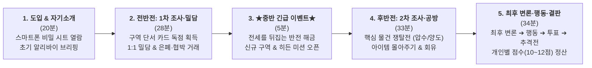

# 📄 [1-Page 기획서] 옛날 옛적 뉴프론티어에서 (Once Upon a Time in New Frontier)

> **한 줄 요약 (Logline)**: 모래폭풍으로 고립된 서부 개척 마을, 실종된 보안관의 행방을 쫓는 **외지인 총잡이 수사관 1인**과 각자의 비밀을 감춘 **마을 주민 6인**이 벌이는 **비대칭 심리 추리 & 협상 머더 미스터리**

---

## 1. 프로젝트 개요 (Overview)

| 항목 | 내용 | 항목 | 내용 |
| :--- | :--- | :--- | :--- |
| **타이틀** | **옛날 옛적 뉴프론티어에서** | **장르** | 서부극 누아르 / 심리 추리 & 협상 파티 게임 |
| **플레이 인원** | **6 ~ 7인** (수사관 1인 + 주민 5~6인) | **플레이 타임** | **120분** (전·후반 2막 구조) |
| **진행 형태** | **오프라인 대면 + 스마트폰 웹 보조 앱** | **레퍼런스** | 파티게임즈 머더 미스터리 시리즈, 영화 《옛날 옛적 서부에서》 |

---

## 2. 시놉시스 & 세계관 (Synopsis)
19세기 말, 황야 끝에 세워진 개척 마을 **'뉴 프론티어'**. 마을에서 무소불위의 권력을 휘두르던 보안관 **'행크'**가 폭풍우 치던 밤 흔적도 없이 사라졌다. 주점 바닥엔 핏자국과 깨진 술병만 남은 아침, 1대 1 결투로는 당해낼 자가 없는 외지인 수사관 **'클라이브'**가 문을 박차고 들어선다.  
***"전임 보안관이 어디 있는지, 어젯밤 무슨 일이 벌어졌는지 해가 지기 전까지 알아내야겠어."***  
고립된 마을 안에서 수사관의 압박과 주민들의 은밀한 뒷거래가 교차하는 가운데, 누구도 예상치 못한 진실이 수면 위로 떠오른다.

---

## 3. 캐릭터 라인업 & 고유 스킬 (Characters & Signature Cards)
각 플레이어는 게임 중 단 1번, **자신만의 시그니처 대사**를 외치며 판세를 뒤집는 고유 능력 카드를 발동할 수 있습니다.

| 구분 | 캐릭터 | 역할 및 표면적 특징 | 시그니처 대사 (고유 액티브 스킬) |
| :---: | :---: | :--- | :--- |
| **수사관** | **🔫 클라이브** | 행크를 찾아온 불패의 총잡이 수사관 | **`"석양이 진다..."`** (1인 투표권 박탈 & 도주 차단) **`"난 뱃지만 찾으면 그만이야"`** (1:1 사법거래 포섭) |
| **용의자 1** | **🍷 애니** | 주점 '원스 어폰 어 타임'의 당찬 여사장 | **`"그저 깊은 잠이 필요했을 뿐..."`** (1인 특수 능력 봉쇄) |
| **용의자 2** | **🎹 베니** | 애니의 곁을 지키는 주점 피아니스트 | **`"Annie, are you OK?"`** (애니를 향한 위협/표 대리 흡수) |
| **용의자 3** | **⭐ 데이비드** | 순직한 선대 보안관의 아들이자 부관 | **`"내가 보안관의 후계자다"`** (상대 보유 단서/아이템 1장 압수) |
| **용의자 4** | **🏛️ 어니스트** | 마을의 철도 이권을 쥔 권력자 시장 | **`"친애하는 뉴 프론티어 마을 여러분!"`** (내 투표권 2표 행사) |
| **용의자 5** | **💉 플로렌스** | 진료소 문을 걸어 잠근 마을 유일의 의사 | **`"응급 환자가 생겼어요. 먼저 가보죠"`** (투표 후보에서 현장 이탈) |
| **용의자 6** | **⛪ 그레이스** | 외곽 성당을 지키는 경건한 수녀 *(7인)* | **`"주께서 저를 지키시나이다"`** (나를 향한 공격 스킬 1회 무효화) |

---

## 4. 핵심 재미 요소 & 게임 진행 루프 (Core Loop & USP)

* **① 독점 단서 카드를 활용한 은폐와 협박**: 조사한 단서와 핵심 물건은 본인 스마트폰 인벤토리에 독점 귀속됩니다. 내 죄를 덮기 위해 증거를 숨기거나, 남의 약점 카드를 쥐고 1:1 밀담에서 거래하는 심리전이 펼쳐집니다.
* **② 전반전과 후반전의 공기가 바뀌는 '중반 긴급 이벤트'**: 단순한 범인 색출에서 끝나지 않고, 중반부 긴급 이벤트가 해금되며 플레이어 간 이해관계가 새롭게 재편됩니다.
* **③ 입체적인 점수제 승리 조건 (10~12점 만점)**: 단순히 범인을 잡거나 숨는 것뿐만 아니라, 각자 고유한 서브/히든 목표를 달성해 고득점을 노리는 다층적 승리 구조를 가집니다.

---

## 5. 스마트폰 웹 보조 앱 구성 (Web Companion Architecture)
오프라인 대면 대화의 몰입감을 해치지 않도록, 인쇄물과 실물 카드를 대체하는 **모바일 웹 수첩(4탭 구조)**으로 제작합니다.
1. **`[📖 내 설정집]`**: 개인 비밀 스토리, 어젯밤 내가 저지른 일, 목표 점수 체크리스트, 시그니처 스킬 전체화면 제시.
2. **`[🔍 단서 구역]`**: 7개 구역(주점·보안관 사무소·타운 홀·마을 진료소·마을 성당·빈 무덤·외곽 폐광)의 뒷면(해당 지역명) 확인 및 내 지갑으로 단독 획득.
3. **`[🎒 내 소지품]`**: 획득한 카드 상세 열람 및 밀담 거래·스킬 압수 시 **`[다른 플레이어에게 즉시 양도하기]`** 기능.
4. **`[🎬 오프닝 & 결말]`**: 공통 오프닝 낭독문, 중반 긴급 이벤트 해금, 결과별 멀티 엔딩 북 및 사건 진상 해설서.
