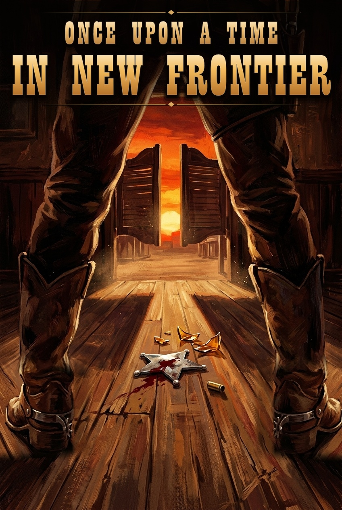

# 🏜️ 머더 미스터리 《옛날 옛적 뉴프론티어에서》 홍보 및 모집 안내문



> *모래폭풍과 눈보라가 삼켜버린 서부의 외딴 마을.*  
> *사라진 보안관, 깨어진 위스키 병, 그리고 문을 박차고 들어선 낯선 총잡이.*  
> *"자, 누구부터 진실을 불어볼까?"*

---

## 📌 게임 기본 정보
* **타이틀**: **《옛날 옛적 뉴프론티어에서》** *(Once Upon a Time in New Frontier)*
* **장르**: 서부극 누아르 / 심리 추리 & 협상 & 총격 서바이벌 머더 미스터리
* **추천 인원**: **6명 ~ 7명** (전원 플레이어 참여 가능 / 별도 전담 GM 없이도 진행 가능)
* **플레이 타임**: 약 120분 (2시간)
* **진행 방식**: 오프라인 대면 플레이 + **스마트폰 전용 웹 보조 앱(디지털 설정집 & 실시간 인벤토리) 완벽 지원**
* **난이도**: ★★★☆☆ (추리와 심리전, 블러핑, 극적인 반전을 좋아하는 분께 강력 추천!)

---

## 📜 시놉시스 (Synopsis)

19세기 말, 거친 황야 끝에 세워진 서부 개척 마을 **'뉴 프론티어(New Frontier)'**.  
이 작은 마을에서 법보다 주먹과 총으로 군림하며 주민들의 원한을 사던 보안관 **'행크(Hank)'**가 폭풍우 치던 어젯밤, 흔적도 없이 사라졌다.

보안관 사무소의 문은 굳게 잠겨 있고, 주점 바닥에는 피 묻은 보안관 배지와 탄피, 깨진 술병 조각만이 뒹굴고 있는 상황.  
마을을 덮친 거대한 모래폭풍으로 외부와의 길이 완전히 끊긴 그날 아침, 흙먼지를 뒤집어쓴 낯선 사내 하나가 살롱의 스윙 도어를 열고 들어선다.

가슴에 은빛 배지를 단 외지인 수사관 **'클라이브(Clive)'**.  
1대 1 결투로는 당해낼 자가 없다는 전설적인 총잡이인 그는 차가운 눈빛으로 리볼버를 어루만지며 마을 사람들을 한 자리에 불러 모은다.

**"전임 보안관 행크가 어디 있는지, 어젯밤 이 마을에서 무슨 일이 벌어졌는지… 해가 지기 전까지 알아내야겠어."**

각자의 비밀과 욕망을 품은 채 침묵하는 마을 사람들, 그리고 그들을 압박해 오는 외지인 보안관.  
과연 어젯밤 뉴 프론티어에서는 무슨 일이 벌어졌는가?

---

## 🎭 등장인물 소개 (6~7인)

### ⭐  수사관] 클라이브 (Clive)
> *"내 질문에 거짓말을 할 생각은 마라. 내 총알은 인내심이 그리 길지 않으니까."*
* 행크의 행방을 쫓아 폭풍을 뚫고 마을에 도착한 베테랑 수사관.
* 누구도 1:1 결투로 이길 수 없는 압도적인 총잡이이며, 날카로운 심문과 은밀한 사법거래로 마을 사람들의 숨통을 조여온다.

### 🍷 [주점 사장] 마담 애니 (Annie)
> *"이 주점에서 벌어지는 일은 전부 제 눈을 피해 갈 수 없죠. 하지만 어젯밤엔… 글쎄요?"*
* 마을의 유일한 안식처인 주점 **'원스 어폰 어 타임'**의 아름답고 당찬 여사장.
* 뛰어난 사교술로 마을의 모든 소문을 꿰고 있으며, 사라진 보안관 행크와 각별한 사이였던 것으로 알려져 있다.

### 🎹 [피아노 연주자] 베니 (Benny)
> *"술 한잔하시죠, 보안관님. 이런 폭풍우 치는 날엔 피아노 선율만큼 마음을 달래주는 것도 없으니까요."*
* 주점 '원스 어폰 어 타임'의 간판 피아니스트.
* 곱상한 외모와 유머 감각으로 누구에게나 호감을 사지만, 주점 사장 애니의 곁을 그림자처럼 맴돌며 무언가를 감추고 있다.

### 🐴 ] 데이비드 (David)
> *"이 마을의 치안은 제가 지킵니다. 외지인이 함부로 총구를 겨누는 건 용납할 수 없습니다."*
* 3년 전 순직한 선대 보안관의 아들이자, 행크의 밑에서 묵묵히 일해 온 젊은 부관.
* 과묵하고 정의감이 투철하여 주민들의 신뢰를 받지만, 상관인 행크의 실종 앞에서 유독 차가운 표정을 짓고 있다.

### 🏛️ [마을 시장] 어니스트 (Ernest)
> *"뉴 프론티어는 평화로운 마을이오! 어서 이 소란을 끝내고 내 집무실로 돌아가야겠소."*
* 뉴 프론티어 마을의 행정과 철도 이권을 주무르는 권력자.
* 말끔한 정장 차림으로 근엄한 위엄을 내세우지만, 행크가 사라지자 누구보다 초조하게 무언가를 찾아 헤매고 있다.

### 💉 [진료소 의사] 플로렌스 (Dr. Florence)
> *"피 냄새와 화약 냄새가 진동하는군요… 다친 곳이 있다면 언제든 제 진료소로 오세요."*
* 황량한 서부 마을의 유일한 의사이자 약사.
* 언제나 차분하고 친절한 미소를 잃지 않지만, 어젯밤 이후로 진료소 문을 굳게 걸어 잠근 채 수상한 피로감을 보이고 있다.

### ⛪ [성당 수녀] 그레이스 (Sister Grace) *(7인 플레이 시 등장)*
> *"이 마을의 모든 죄인들이… 부디 신의 가호 아래 참회할 기회를 얻기를 기도합니다."*
* 마을 외곽의 낡은 목조 성당을 지키는 경건하고 자비로운 수녀.
* 범죄와 폭력이 난무하는 마을에서 유일하게 순결한 존재로 존경받지만, 폭풍우 치던 어젯밤 성당 주변에서 낯선 그림자가 목격되었다.

---

## ✨ 이 게임만의 4가지 핵심 매력 포인트

1. **서부극 특유의 낭만과 '시그니처 대사 스킬'**
   * 모든 캐릭터는 게임 중 단 한 번, 불리한 판세를 뒤집을 수 있는 **고유 특수 능력**을 가지고 있습니다.
   * 결정적인 순간, *"석양이 진다..."*, *"그저 깊은 잠이 필요했을 뿐..."*, *"Annie, are you OK?"* 등 캐릭터만의 시그니처 대사를 외치며 판을 흔드는 짜릿한 쾌감을 경험하세요!
2. **은폐할 것인가, 거래할 것인가! 독점 단서와 정체불명의 물품들**
   * 현장에서 발견한 단서와 아이템은 조사한 사람의 인벤토리에 **단독으로 귀속**됩니다.
   * 조사 도중 발견되는 *"💥 굉장히 위험해 보이는 물품"*과 *"🛡️ 생존에 유용해 보이는 물품"*의 정체는 무엇일까요? 나에게 불리한 증거는 숨기고, 상대방이 간절히 원하는 물건을 미끼로 1:1 밀담과 사법거래를 성사시키세요!
3. **단순한 범인 색출로 끝나지 않는 드라마틱한 후반부와 7종 멀티 엔딩**
   * 이야기가 중반을 넘어서는 순간, 마을 전체를 뒤흔드는 사건과 함께 모든 인물의 이해관계가 폭발합니다.
   * 당신의 선택과 협상, 그리고 최후의 결단에 따라 달라지는 **7가지 시네마틱 멀티 엔딩** 중 과연 누가 뉴 프론티어의 최종 승자가 될까요?
4. **별도 GM 없이도 완벽하게! 스마트폰 전용 웹 보조 앱 지원**
   * 방 코드만 입력하면 참가자 전원의 스마트폰이 실시간으로 연동됩니다.
   * **비밀 설정집 열람, 스네이크 드래프트 단서 획득, 타 플레이어에게 은밀한 아이템 양도, 단계별 암호 해금**까지 터치 한 번으로 쾌적하게 즐기실 수 있습니다.

---

## 💬 참가자 모집 공지용 1분 요약 템플릿 (카톡/디스코드 복사용)

```text
🏜️ [머더 미스터리 모집] 《옛날 옛적 뉴프론티어에서》 (6~7인)

"사라진 보안관, 주점 바닥에 떨어진 피 묻은 배지, 그리고 폭풍을 뚫고 찾아온 낯선 총잡이."
과연 어젯밤, 서부 개척 마을 '뉴 프론티어'에서는 무슨 일이 벌어졌을까요?

✅ 인원: 6~7명 (전원 플레이어 참여)
✅ 소요 시간: 약 120분
✅ 특징:
- 서부극 누아르 감성의 심리 추리 & 협상 & 서바이벌
- 판세를 뒤집는 캐릭터별 '시그니처 대사 궁극기'
- 스마트폰 전용 웹 수첩 지원 (은밀한 카드 거래 & 실시간 인벤토리)

🎭 등장인물:
⭐ 클라이브 (외지인 수사관)
🍷 마담 애니 (주점 사장)
🎹 베니 (피아노 연주자)
🐴 데이비드 (마을 부보안관)
🏛️ 어니스트 (마을 시장)
💉 플로렌스 (진료소 의사)
⛪ 그레이스 (성당 수녀 / 7인 시 등장)

함께 서부의 총성과 심리전 속으로 떠나실 분은 댓글/투표 남겨주세요! 🤠🥃
```
