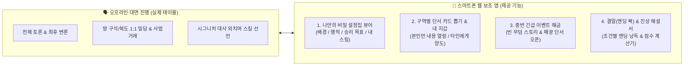
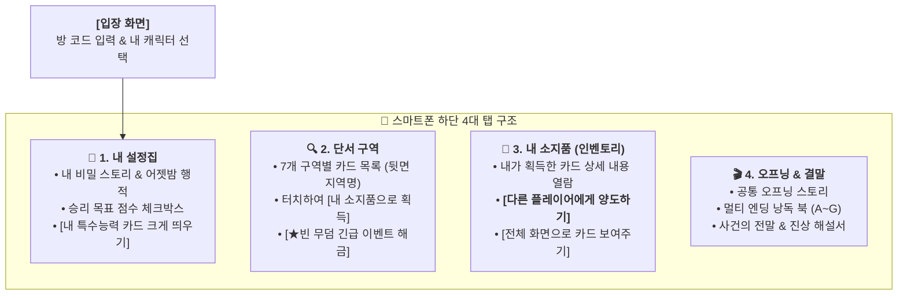

# ⚙️ 《옛날 옛적 뉴프론티어에서》 오프라인 파티게임즈 포맷 & 웹 보조 앱 설계서

> 본 문서는 **오프라인 대면 모임(파티게임즈 머더 미스터리 형식)**으로 게임을 진행할 때, 인쇄물(종이 책자와 실물 카드)을 대체하고 진행을 매끄럽게 도와주는 **스마트폰용 웹 보조 앱(Web Companion App)** 및 게임 진행 규칙 설계서입니다.  
> *(※ 복잡한 인게임 자동 판정이나 채팅 기능 대신, 오프라인 플레이어들이 각자 스마트폰으로 **개인 설정집 열람, 단서/아이템 카드 단독 획득 및 양도, 긴급 이벤트 해금, 결말(엔딩 북) 확인**을 할 수 있도록 보조하는 것에 집중합니다.)*

---

## 💡 오프라인 플레이 + 웹 보조 앱(Companion App) 운영 개념

오프라인에서 플레이어 6~7명이 한자리에 모여 직접 대화하고 밀담을 나누며, 스마트폰 웹페이지 화면을 **'나만의 디지털 설정집 & 카드 지갑'**으로 사용합니다.

---

## 1. 웹 보조 앱이 제공하는 5대 핵심 기능

실제 게임 규칙 적용(대화, 협상, 스킬 선언 타이밍)은 오프라인에서 플레이어들끼리 진행하고, 웹은 아래 **5가지 보조 도구**만 깔끔하게 제공합니다.

### ① 캐릭터 선택 및 비밀 설정집 뷰어 (Character Booklet)
* 방 코드(또는 공용 세션)에 접속해 자신이 맡은 캐릭터(클라이브 ~ 그레이스)를 선택합니다. (실수로 남의 시트를 보지 않도록 간단한 4자리 PIN 또는 확인창 적용)
* **내 화면에만 보이는 탭**:
  * **내 프로필 & 비밀 서사**: 내가 왜 행크를 죽이는 데 가담했는지(혹은 왜 찾는지) 상세 스토리.
  * **어젯밤 내가 저지른 일 (어젯밤 행적)**: 알리바이 추궁에 대비한 어젯밤 나의 행적.
  * **나의 승리 목표 & 점수표**: 10~12점 만점 체크리스트 (터치하면 내 예상 점수가 계산됨).
  * **내 시그니처 능력 카드**: 오프라인에서 스킬을 선언할 때 화면에 크게 띄워 남들에게 보여줄 수 있는 **`[카드 제시하기 (전체화면)]`** 기능.

### ② 단서/아이템 카드 획득 및 양도 시스템 (Clue & Item Wallet)
* **구역별 카드 보드**:
  * 화면에 각 구역(주점, 보안관 사무소, 타운 홀, 마을 진료소, 마을 성당 등)의 카드들이 **뒷면에는 모두 해당 지역명**(예: `[마을 성당]`)만 보이게 나열되어 있습니다.
* **본인만 열람 (단독 획득)**:
  * 내 조사 차례에 원하는 카드를 터치해 **`[단서 획득하기]`**를 누르면, 그 카드는 **내 스마트폰의 `[내 소지품(인벤토리)]` 탭**으로 들어옵니다.
  * 다른 사람들의 화면에서는 해당 카드가 **"획득됨 (소유자 비공개 또는 표시)"**으로 바뀌어 중복 획득이 방지되고, **카드 앞면(상세 내용)은 획득한 본인만 볼 수 있습니다.**
* **보여주기 & 양도하기 (Transfer)**:
  * **오프라인 밀담 시**: 내 폰 화면을 상대에게 직접 보여주며 정보를 공유하거나 거짓말로 요약해 줄 수 있습니다.
  * **양도(전달) 버튼**: 각 카드 하단에 있는 **`[다른 캐릭터에게 양도하기]`** 버튼을 눌러 대상을 선택하면, 내 인벤토리에서 카드가 사라지고 **상대방의 스마트폰 인벤토리로 카드가 즉시 이동**합니다!
    * *활용 1*: 밀담에서 단서 카드 1:1 맞교환 거래 시.
    * *활용 2*: **`[피 묻은 연방 보안관 배지]`**나 **`[비리 장부]`**를 클라이브나 어니스트에게 넘겨줄 때.
    * *활용 3*: 데이비드가 오프라인에서 **`"내가 보안관의 후계자다!"`**를 외치며 압수 능력을 썼을 때, 지목당한 사람이 데이비드에게 카드를 양도 처리할 때.

### ③ 중반 긴급 이벤트 《빈 무덤의 진실》 해금 버튼
* 전반전(1차 조사 및 토론)이 끝났을 때, 진행자(또는 클라이브 플레이어)가 웹에서 **`[★긴급 이벤트 개봉: 빈 무덤]`** 버튼을 누릅니다.
* 모든 플레이어의 화면에 **《빈 무덤의 진실: 행크가 살아있다!》** 특별 시트가 해금되며, 캐릭터 설정집 하단에 감춰져 있던 **`[히든 미션(행크 사살 vs 생존)]`** 항목이 나타납니다.
* 동시에 단서 탭에 신규 구역 2곳인 **`[구역 6: 외곽 마른 나무 (빈 무덤)]` (3장)**과 **`[구역 7: 외곽 폐광 (은신처)]` (4장)** 카드 더미가 새로 열려 2차 조사를 진행할 수 있게 됩니다.

### ④ 보조 타이머 & 페이즈 안내판 (총 120분 코스)
* 게임을 강제로 통제하지 않고, 현재 어떤 단계인지 알려주는 가이드 및 스톱워치 역할만 수행합니다.
  * `1. 오프닝 & 설정집 정독 (10분)` ➔ `2. 자기소개 & 1차 발언 (10분)` ➔ `3. 1차 조사 (8분)` ➔ `4. 전반전 대화·밀담 (20분)` ➔ `5. ★빈 무덤의 반전 (5분)` ➔ `6. 2차 조사 (8분)` ➔ `7. 후반전 밀담 & 아이템 몰아주기 (25분)` ➔ `8. ★최후 변론 (7분)` ➔ `9. ★그레이스·클라이브 비밀 지목 (1분)` ➔ `10. 행동 단계 (5분)` ➔ `11. 최종 투표 단계 (5분)` ➔ `12. 행크 추격전 (5분)` ➔ `13. 엔딩 & 점수 정산 (11분)`

### ⑤ 결말(엔딩 북) & 사건의 전말 해설 뷰어
* 오프라인에서 최종 범인 지목 투표와 **행크 생사 주사위 결판(개인별 주사위 + 전용 아이템 개당 `+1` 보너스 합산)**을 마친 뒤, **`[결말(엔딩 북) 열기]`** 탭으로 이동합니다.
* 결과 조건(**7인 캐릭터별 단독 1위 엔딩 `Ending A ~ Ending G`**)을 선택하면, 다 같이 읽을 수 있는 **시네마틱 엔딩 대본**이 출력됩니다.
  * *(※ **최종 점수 동점 판정**: 점수가 동점일 경우 **`[행크 추격전]` 주사위 판정 1등인 인물**이 최종 승리하며, **애니와 베니가 공동 1등**일 경우에는 `Ending A`와 `Ending B`를 함께 이어서 읽습니다.)*
* 마지막으로 **`[사건의 전말 & 진상 해설서]`**를 열어 숨겨진 모든 트릭과 각 캐릭터의 진짜 정체를 확인하며 담소를 나눕니다.

---

## 2. 클라이맥스 흐름 & [전용 아이템(개당 +1) + 주사위 최고 눈금(막타 독점)] 판정

2차 조사와 후반전 밀담(아이템 양도 거래)이 끝나면, **`[최후 변론 (7분)]` ➔ `[비밀 정체 지목 (1분)]` ➔ `[행동 단계 (5분)]` ➔ `[투표 단계 (5분)]` ➔ `[행크 추격전 (5분)]`** 순서로 클라이맥스가 진행됩니다.

* **`[최후 변론]` (7분)**: 1인당 1분씩 광장에서 마지막 변론 및 의심자 지목을 진행합니다.
* **`[비밀 정체 지목]` (최후 변론 직후 1분)**: 행동 단계에서 각자의 스킬과 정체가 드러나기 전에, **그레이스는 `[매드독]`이 누구인지**, **클라이브는 `[행크의 조력자(그레이스/플로렌스)]`가 누구인지** 비공개로 지목합니다.
* **`[행동 단계]` 스킬 발동 (5분)**: 비밀 지목 직후 열리는 별도 단계로, **클라이브(`리볼버 1순위`)**, **애니(`수면제 1순위`)**, **데이비드(`1장 압수 2순위`)**, **플로렌스(`왕진 도주 3순위`)**, **그레이스(`무적 0순위 반응`)**가 이 단계에서 스킬을 사용합니다.
* **`[투표 단계]` 전용 스킬 발동**: 오직 **어니스트(`2표 선동`)**와 **베니(`애니 대리 희생`)** 두 명만 **[투표 단계]**에서 스킬을 사용할 수 있습니다! *(단, 앞선 행동 단계에서 애니의 수면제에 찍혔다면 투표 단계에서도 사용 불가)*

> **🚨 핵심 연결 규칙 (유치장 수감 효과 & 클라이브 탈옥 판정)**:  
> **`[투표 단계]`에서 최다 득표로 체포된 최종 범인(1명)은 유치장에 수감되므로, 뒤이어 열리는 `[행크 추격전(주사위 결판)]`에 참여할 수 없습니다!**  
> *(※ 베니의 `"Annie, are you OK?"`로 애니 대신 감옥에 들어가거나, 플로렌스의 `"응급 환자가 생겼어요..."`로 투표 후보에서 이탈하면 체포를 피해 행크 추격전에 정상 참여 가능! 또한 **클라이브**가 최다 득표로 수감된 경우, 추격전 직전 **주사위를 굴려 `4 이상(4~6, 확률 50%)`이 나오면 탈옥에 성공**해 행크 추격전에 정상 참여합니다!)*

### 2.1. 최종 눈금 합산 공식
수감되지 않은 플레이어들 중 행크 추적에 나서는 플레이어들은 각자 **6면체 주사위(1~6)**를 굴립니다.

$$\text{최종 눈금} = \text{내 주사위 결과 (1\sim6)} + \text{내 소지품의 전용 아이템 보너스 (개당 +1)} \quad (\text{※ 클라이브는 기본 } +1 \text{ 추가})$$

* **🔫 클라이브 패시브 `[전설적인 총잡이]`**: 단독 1인의 불리함을 보정하여 클라이브는 항상 기본 `+1` 보너스를 받고 시작합니다 (보너스 수치: `+1` / `+2` / `+3` / `+4` / `+5`).
* **가장 큰 최종 눈금(1위)을 기록한 단 1명**이 행크에게 가장 먼저 도달하여 운명을 결정짓습니다.
* *(※ 웹 보조 앱의 `[🎒 내 소지품]` 탭 상단에 내가 현재 보유한 아이템에 따른 **주사위 자동 보너스 수치**가 실시간으로 표시됩니다!)*

### 2.2. 막타 독점 & 7인 추격전 점수 판정

| 최고 눈금 1위 달성자 | 행크의 최후 | 점수 판정 (막타 독점 규칙) |
| :---: | :---: | :--- |
| **🔫 클라이브 1위** | **💥 행크 사망** | • **클라이브만 `[+5점]` 독점 획득!** *(+회유서로 매수된 주민도 클라이브가 행크 사살 시 +5점 획득!)* • *타 캐릭터는 추격전 점수 0점* |
| **🍷 애니 또는 🎹 베니 1위** | **💥 행크 사망** | • **애니 `[+3점]` & 베니 `[+3점]` 공동 획득!** (운명 공동체인 두 사람 중 한 명만 1위를 해도 둘 다 달성) • *타 캐릭터 및 클라이브에게 매수된 주민은 추격전 점수 0점* |
| **⭐ 데이비드 1위** | **⛓️ 행크 제압(체포)** | • **데이비드만 `[+3점]` 독점 획득!** (원수 행크를 직접 제압·체포 성공) • *타 캐릭터는 추격전 점수 0점* |
| **🏛️ 어니스트 1위** | **💥 행크 제압(생매장)** | • **어니스트만 `[+3점]` 독점 획득!** (비리 증인 행크를 직접 제압·생매장 성공) • *타 캐릭터는 추격전 점수 0점* |
| **💉 플로렌스 1위** | **🛡️ 행크 생존(도주)** | • **플로렌스만 `[+3점]` 독점 획득!** (행크를 직접 구출·도주시켜 치부 은폐 성공) • *그레이스를 포함한 타 캐릭터는 추격전 점수 0점* |
| **⛪ 그레이스 1위** | **🛡️ 행크 생존(구원)** | • **그레이스만 `[+5점]` 독점 획득!** (아버지 행크를 직접 구출해 참회시키는 데 성공) • *플로렌스를 포함한 타 캐릭터는 추격전 점수 0점* |

### 2.3. 사살·제압용 4종 파츠 vs 생존(구출)용 2종 파츠

| 분류 | 아이템 카드 명칭 (총 6장) | 보유 보너스 효과 (개당 `+1` 합산) |
| :---: | :--- | :---: |
| **💥 사살·제압 아이템 4종** *(클라이브 / 애니·베니 / 데이비드 / 어니스트용)* | • **`[무기] 대구경 콜트 리볼버`** *(주점)* • **`[탄환] 할로우 포인트 특수 탄약`** *(시장실)* • **`[포박] 올가미 밧줄`** *(빈 무덤)* • **`[추적] 폐광 갱도 비밀 지도`** *(폐광)* | **개당 `+1`** *(1개 +1 / 2개 +2 / 3개 +3 / 4개 +4)* |
| **🛡️ 생존 아이템 2종** *(플로렌스 / 그레이스용)* | • **`[의술] 응급 외과 봉합 키트`** *(진료소)* • **`[방어] 강철 방탄 조끼`** *(성당)* | **개당 `+1`** *(1개 +1 / 2개 +2)* |

* **팀원 간 몰아주기(양도)**: `애니+베니(운명 공동체)` 팀이나 `클라이브+회유서 매수 주민` 팀은 웹 앱의 **`[양도하기]`** 기능을 통해 한 사람에게 아이템을 몰아주어 `+2` ~ `+4` 보너스를 만들 수 있습니다. *(반면 플로렌스와 그레이스는 주사위 1위 본인만 생존 점수를 독점하므로 서로 아이템을 차지하기 위한 심리전을 벌입니다.)*
* **데이비드 & 어니스트의 직접 추격 및 협상 플레이**: 데이비드와 어니스트 역시 행크 제압(`+3점`)을 위해 사살·제압 파츠를 직접 모으거나, **`[피 묻은 연방 보안관 배지 (+2점)]`**와 **`[비리 장부 (+2점)]`**를 둘러싼 거래를 펼칩니다.

---

## 3. 오프라인 진행을 위한 상세 콘텐츠 설계 목록

웹 보조 앱에 탑재할 **텍스트 콘텐츠(데이터)**의 전체 구성입니다.

### 3.1. 공통 오프닝 & 긴급 이벤트 스크립트 (2종)
1. **오프닝 나레이션 (`opening.md`)**: 폭풍우 치는 뉴 프론티어 마을에 외지인 보안관 클라이브가 도착하며 시작되는 도입부 낭독문.
2. **중반 긴급 이벤트 (`mid_event.md`)**: 마을 외곽의 무덤을 파헤쳤으나 찢어진 마대 자루와 손톱자국만 남아있는 '빈 무덤' 반전 낭독문.

### 3.2. 7인 캐릭터 비밀 설정집 전문 (7종)
각 플레이어가 자기 스마트폰으로 읽을 1인칭 시점의 몰입감 있는 설정집입니다.
* **`[C] 클라이브 설정집`**: 매드독 갱단 과거사, 가짜 배지의 비밀, 행크의 배지 추격 목표, 1:1 밀담 & 리볼버/회유서 사용 가이드. *(※ 회유서를 건네받아 수락한 주민은 5점 목표가 '클라이브가 행크 사살 시 (+5점)'로 변경됨)*
* **`[A] 애니 설정집`**: 행크와의 애증과 폭력, 5인 살해 공모 주도 과정, 마지막 칼질의 기억, 베니를 향한 미안함, 수면제 카드 사용 가이드.
* **`[B] 베니 설정집`**: 애니를 향한 순애보, 마차로 시신을 운반한 밤, 애니 수호 목표, 대리 희생 카드 사용 가이드.
* **`[D] 데이비드 설정집`**: 3년 전 아버지의 의문사, 라이플 개머리판 가격, 사라진 아버지의 배지 추적, 증거품 1장 압수 카드 사용 가이드.
* **`[E] 어니스트 설정집`**: 도난당한 철도 부지 비리 장부, 폐광 토지 제공과 구타 가담, 장부 회수(+2점) 및 행크 제압(+3점) 목표, 2표 선동 카드 사용 가이드.
* **`[F] 플로렌스 설정집`**: 모르핀 과잉 진료 약점, 치사량 마취제 제공 후 **새벽 3시에 살아 돌아온 행크의 총구 협박과 응급 봉합**, 행크 생존 목표, 왕진 도주 카드 사용 가이드.
* **`[G] 그레이스 설정집`**: 아버지 행크가 살아 참회하길 바라는 수녀의 기도, 마을에 숨어든 '매드독'에 대한 소문, 신성한 가호(1회 무적) 카드 사용 가이드.

### 3.3. 단서 및 아이템 카드 (총 7개 구역 / 24장 완료)
* **1차 조사 구역 (5곳 / 17장)**:
  * `1. 주점(3장 - 핵심: 비리 장부 포함)` / `2. 보안관 사무소(3장 - 사살1: 콜트 리볼버 포함)` / `3. 타운 홀(3장 - 사살2: 특수 탄약 포함)` / `4. 진료소(4장 - 생존1: 봉합 키트, 피 묻은 수술 도구 포함)` / `5. 성당(4장 - 핵심: 연방 보안관 배지, 생존2: 방탄 조끼, 아버지와 찍은 사진 포함)`
* **2차 조사 구역 (2곳 / 7장 - 중반 빈 무덤 이벤트 해금 후 오픈)**:
  * `6. 외곽 마른 나무 - 빈 무덤(3장 - 사살·제압3: 올가미 밧줄 포함)` / `7. 외곽 폐광 - 은신처(4장 - 사살·제압4: 폐광 지도, 암벽에 피로 적힌 글귀 포함)`
* *(※ 24장 전체 앞/뒷면 상세 텍스트는 [`GAME_DESIGN.md` 7번 섹션](./GAME_DESIGN.md)에 수록 완료)*

---

## 4. 웹 보조 앱 화면 구조 (UI Wireframe)

스마트폰 세로 화면(Mobile-First)에 최적화된 하단 탭 바(Bottom Navigation) 구조입니다.

---

## 5. 기술 구현 방식 (가볍고 즉각적인 구조)

오프라인 보조 앱이므로 무거운 게임 엔진 없이 **직관적인 상태 공유**만 있으면 즉시 플레이 가능합니다.

1. **실시간 카드 상태 공유**:
   * 누가 어떤 카드를 가져갔고(`takenBy`), 누구에게 양도했는지(`transferTo`), 그리고 중반 이벤트(`midEventUnlocked`)가 열렸는지만 동기화합니다.
   * **구현 옵션 A (로컬/단일 서버 WebSocket 또는 가벼운 JSON API)**: 같은 Wi-Fi나 링크로 접속한 7명의 스마트폰에서 카드 획득/양도가 실시간 반영됨.
   * **구현 옵션 B (완전 서버리스 모드 병행 지원)**: 인터넷이나 서버 세팅 없이도 쓸 수 있도록, 카드 양도 시 상대방이 번호를 눌러 받거나 즉시 열람하는 수동 토글 옵션도 함께 제공하면 어떤 환경에서도 100% 작동 보장.
